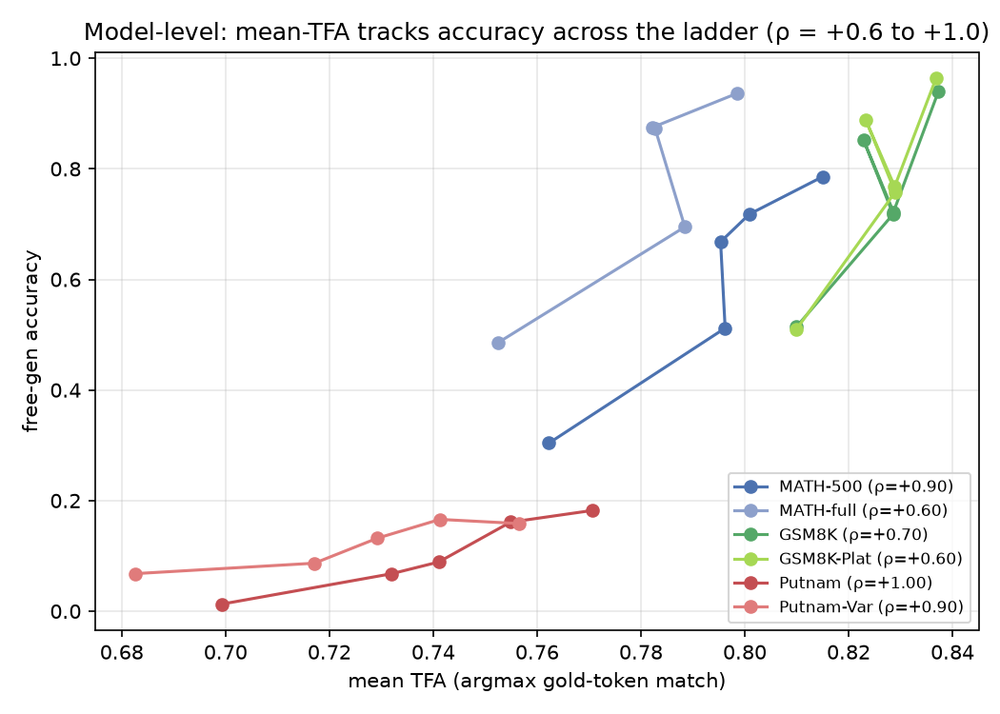
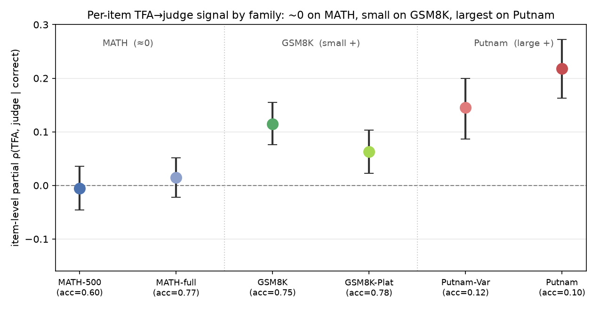

# judge-and-gold-free-eval (formerly judge-free-eval)

> **Goal (Brando, 2026-11-24).** Find a metric that **replaces the gold reference / target metrics**
> (human labels, boxed-answer accuracy, pass@k). Replacing LLM judges too is a bonus. **The more
> trustworthy the better**: a candidate must pass falsifiable sanity properties (invariance,
> monotonicity, repeat stability, bug detection, no confident wrongness), not only correlate with
> humans or gold. The project idea: human agreement alone is not sufficient to trust a metric;
> foundational properties are needed too (and humans and boxed accuracy can be checked against them).
>
> **Current state.** Gold-free self-consistency on MATH-500. Experiment 02
> ([`RESULTS.md`](experiments/02_gold_free_self_consistency/RESULTS.md)) beats no-reference judges and
> fails the preregistered bar for replacing boxed accuracy. Experiments 03 and 04 rank models like
> pass@1; the paper numbers are in [Results](#results) and [`RESULTS.md`](RESULTS.md). The one proposed
> next run is [`NEXT.md`](NEXT.md). The TFA study below is experiment 01 in spirit
> (`experiments/tfa-vs-judge/`).
>
> **Rules.** No branches: commit to main. One numbered folder per experiment, each with README, PREREG
> committed before running, scripts, results, RESULTS.md. The metric must say what it needs
> (gold, judge, humans) in every table.

## Results

Paper-ready results for experiments 03 and 04. Every figure is a committed output. This section does not draw new samples. Self-consistency (SC) needs no gold answer, no human label, and no judge. Pass@1 needs the gold answer. The same text is in [`RESULTS.md`](RESULTS.md). Paths point at the file that stores the number.

### Experiment 03: model-level SC versus pass@1

Six instruction models, the same 500 MATH-500 problems, $n = 16$ samples (temperature $1.0$, top-p $0.95$, 1024 new tokens, seed 0). Model-level SC is the mean, over problems, of pairwise agreement of normalized answer keys. An unboxed sample scores $0$ and counts wrong. The frozen rule in [`experiments/03_model_level_ranking_sc/PREREG.md`](experiments/03_model_level_ranking_sc/PREREG.md) returns YES when the number of discordant pairs satisfies $D \le 2$ out of 15, every discordant pass@1 gap is below $0.05$, and a 2000-draw problem-cluster bootstrap has $P(D \le 3) \ge 0.80$.

**Verdict: YES.** SC orders the six models as pass@1 does, with one discordant pair: $D = 1$, Kendall $\tau = 0.867$, Spearman $\rho = 0.943$, Pearson $r = 0.997$, $P(D \le 3) = 1.00$, and the bootstrap 95% interval for $\tau$ is $[0.73, 0.87]$. Source: [`experiments/03_model_level_ranking_sc/results/results.json`](experiments/03_model_level_ranking_sc/results/results.json) (`E1.sc`, `E1.sc.pearson`, `E1_boot.sc`, `E1_verdict`) and [`experiments/03_model_level_ranking_sc/results/tables.md`](experiments/03_model_level_ranking_sc/results/tables.md).

The discordant pair is DeepSeek-Math-7B-RL (pass@1 $0.145$, SC $0.048$) versus Mistral-7B-Instruct-v0.2 (pass@1 $0.102$, SC $0.062$). The pass@1 gap is $0.043$ (exact value $0.042625$ in `E1_discordant_pairs`). The bootstrap probability that this pair matches pass@1 is $0.007$ (`E1_pair_concordance_prob`). DeepSeek-Math boxes $0.263$ of its samples (`model_level.dsmath_7b_rl.boxed`). The gap sits under the frozen line of $0.05$. The lab note flags that a format-robust gold grader could move it ([`experiments/03_model_level_ranking_sc/RESULTS.md`](experiments/03_model_level_ranking_sc/RESULTS.md)); experiment 04 measures that grader.

The boxed-rate control has $D = 4$ ($\tau = 0.467$), so the SC order carries information beyond whether a sample contains a box. Mean SCP matches SC ($D = 1$, $\tau = 0.867$). Majority@16 and pass@16, both gold-using, have $D = 0$.

SC orders models and sits below pass@1 on every model. Pearson $r(\mathrm{SC}, \mathrm{pass@1}) = 0.997$, and $\mathrm{SC} - \mathrm{pass@1}$ runs from $-0.04$ to $-0.10$ (`E2`, and the same range in the lab note). At plurality share $\mathrm{SCP} \ge 0.5$, Mistral's precision is $0.742$ on coverage $0.062$ (`E3`; `tables.md`). The pre-registered line, precision $\ge 0.90$ for every model, fails for Mistral.

| model | pass@1 | SC | boxed rate |
|---|---:|---:|---:|
| Qwen2.5-7B-Instruct | 0.721 | 0.680 | 0.910 |
| Qwen3-4B (non-thinking) | 0.702 | 0.662 | 0.767 |
| Qwen3-1.7B (non-thinking) | 0.633 | 0.580 | 0.747 |
| Llama-3.1-8B-Instruct | 0.377 | 0.281 | 0.723 |
| DeepSeek-Math-7B-RL | 0.145 | 0.048 | 0.263 |
| Mistral-7B-Instruct-v0.2 | 0.102 | 0.062 | 0.834 |

Three-decimal figures as printed in [`experiments/03_model_level_ranking_sc/results/tables.md`](experiments/03_model_level_ranking_sc/results/tables.md). Exact floats are in `results.json` under `model_level`. Figure: [`experiments/03_model_level_ranking_sc/results/model_rank.png`](experiments/03_model_level_ranking_sc/results/model_rank.png).

### Experiment 04: format-robust SC

The extractor in [`experiments/04_format_robust_sc_and_more_models/scripts/fr_extract.py`](experiments/04_format_robust_sc_and_more_models/scripts/fr_extract.py) keeps a boxed answer and otherwise falls back through a final-answer phrase, the last math expression, and a trailing number. The primary comparison applies that extractor on both sides: format-robust SC versus format-robust pass@1. Strict pass@1 is the experiment 03 target (boxed answer, else wrong). Part A re-scores the six experiment 03 sample files. Part B adds four models sampled with the same harness. Rules were frozen in [`experiments/04_format_robust_sc_and_more_models/PREREG.md`](experiments/04_format_robust_sc_and_more_models/PREREG.md) before any fallback number.

#### Part A (six models, no new sampling)

**Verdict: YES.** $D = 0$ of 15, $\tau = 1.000$, Spearman $\rho = 1.000$, $P(D \le 3) = 1.00$. The stored bootstrap 95% interval for $\tau$ is $[0.866667, 1.0]$ (`A.primary_scfr_vs_p1fr.tau_ci` in [`experiments/04_format_robust_sc_and_more_models/results/results.json`](experiments/04_format_robust_sc_and_more_models/results/results.json)).

DeepSeek-Math-7B-RL versus Mistral-7B-Instruct-v0.2 is concordant. Format-robust SC is $0.494$ versus $0.069$ (strict SC was $0.048$ versus $0.062$). Format-robust pass@1 is $0.506$ versus $0.105$ (strict pass@1 was $0.145$ versus $0.102$). The bootstrap probability of concordance is $1.00$ (`flip_dsmath_vs_mistral.sc_fr_vs_p1_fr`). The phrase tier covers $0.66$ of DeepSeek-Math-7B-RL samples (`tables.md`), which is why strict scoring had placed it last among the gold-free metrics.

#### Part B (ten models)

**Verdict: YES** under the Part B rule: $\tau \ge 0.80$, every discordant format-robust pass@1 gap below $0.05$, and $P(\tau \ge 0.733) \ge 0.80$. The estimate is $D = 1$ of 45, $\tau = 0.956$, Spearman $\rho = 0.988$, bootstrap 95% interval $[0.87, 1.00]$ ([`experiments/04_format_robust_sc_and_more_models/RESULTS.md`](experiments/04_format_robust_sc_and_more_models/RESULTS.md); stored `tau_ci` is $[0.866667, 1.0]$), and $P(\tau \ge 0.733) = 1.00$. The problem-cluster probability $P(D \le 3)$ is $0.9985$ (`B.primary_scfr_vs_p1fr.boot_P_D_le_3`), printed as $1.00$ in `tables.md`.

The discordant pair is Qwen3-4B versus Qwen3-8B, both non-thinking: format-robust pass@1 $0.710$ versus $0.714$ (gap $0.004$; exact gap $0.00425$), format-robust SC $0.680$ versus $0.678$ (`tables.md`; `B.primary_scfr_vs_p1fr.discordant`).

Over the ten models, Pearson $r = 0.995$ between format-robust SC and format-robust pass@1, and format-robust SC reads $0.012$ to $0.089$ below format-robust pass@1 ([`experiments/04_format_robust_sc_and_more_models/RESULTS.md`](experiments/04_format_robust_sc_and_more_models/RESULTS.md); per-model values in `results.json` `table`). Four pairs have a format-robust pass@1 gap below $0.05$, and three of those four are concordant (`close_pairs_all` in `results.json`, listed in `tables.md`).

| model | pass@1 strict | pass@1 fr | SC strict | SC fr | boxed | phrase | cut at 1024 |
|---|---:|---:|---:|---:|---:|---:|---:|
| Qwen2.5-7B-Instruct | 0.721 | 0.724 | 0.680 | 0.686 | 0.91 | 0.00 | 0.09 |
| Qwen3-8B (non-thinking) | 0.705 | 0.714 | 0.661 | 0.678 | 0.76 | 0.01 | 0.25 |
| Qwen3-4B (non-thinking) | 0.702 | 0.710 | 0.662 | 0.680 | 0.77 | 0.01 | 0.24 |
| Qwen3-1.7B (non-thinking) | 0.633 | 0.640 | 0.580 | 0.595 | 0.75 | 0.01 | 0.26 |
| Qwen3.5-4B (non-thinking) | 0.537 | 0.571 | 0.482 | 0.520 | 0.55 | 0.00 | 0.45 |
| DeepSeek-Math-7B-RL | 0.145 | 0.506 | 0.048 | 0.494 | 0.26 | 0.66 | 0.08 |
| DeepSeek-Math-7B-Instruct | 0.412 | 0.413 | 0.345 | 0.346 | 0.96 | 0.00 | 0.03 |
| Llama-3.1-8B-Instruct | 0.377 | 0.397 | 0.281 | 0.308 | 0.72 | 0.01 | 0.00 |
| Llama-3-8B-Instruct | 0.237 | 0.239 | 0.160 | 0.164 | 0.96 | 0.01 | 0.03 |
| Mistral-7B-Instruct-v0.2 | 0.102 | 0.105 | 0.062 | 0.069 | 0.83 | 0.02 | 0.14 |

Rows and rounding as printed in [`experiments/04_format_robust_sc_and_more_models/results/tables.md`](experiments/04_format_robust_sc_and_more_models/results/tables.md). Figure: [`experiments/04_format_robust_sc_and_more_models/results/model_rank.png`](experiments/04_format_robust_sc_and_more_models/results/model_rank.png).

| comparison | Part A | Part B |
|---|---|---|
| SC fr vs pass@1 fr (primary) | $0/15$, YES | $1/45$, YES |
| SC fr vs pass@1 strict | $1/15$, NO (max gap $0.232$) | $4/45$, NO (max gap $0.267$) |
| SC strict vs pass@1 strict | $1/15$, YES (gap $0.043$) | $2/45$, YES (gap $0.043$) |
| S1, fallback off when cut at 1024 | $0/15$, YES | $2/45$, YES (max gap $0.032$) |
| S2, boxed and phrase tiers only | $0/15$, YES | $2/45$, YES (max gap $0.033$) |

Source for this block: the Part A and Part B tables in [`experiments/04_format_robust_sc_and_more_models/results/tables.md`](experiments/04_format_robust_sc_and_more_models/results/tables.md). S1's extra discordant pair on the ten-model set is DeepSeek-Math-7B-RL versus Qwen3.5-4B.

#### Scope of the claim

The primary YES uses the same extractor on the candidate and on the target. Against strict pass@1, format-robust SC is a NO on both parts, because strict pass@1 leaves DeepSeek-Math-7B-RL at $0.145$ while the fallback scores it at $0.506$. Qwen3.5-4B has $0.45$ of its samples cut at 1024 tokens, so its fallback answers include mid-reasoning guesses; S1 and S2, which drop those guesses, stay YES and add that one pair. An independent recompute matches `analyze.py` to $10^{-15}$ on all ten models ([`experiments/04_format_robust_sc_and_more_models/results/indep_check.json`](experiments/04_format_robust_sc_and_more_models/results/indep_check.json)). The ranking is one benchmark (MATH-500), $n = 16$, and final-answer tasks. The proposed next run is [`NEXT.md`](NEXT.md).

**When can a cheap, judge-free signal evaluate reasoning?**

Evaluating reasoning at scale currently means paying a frontier LLM judge on every response. This
project asks how far you can get without one: with a deterministic, reproducible signal that costs a
single forward pass and needs no judge and no human labels in the metric itself. We take the most
natural candidate, **Teacher-Forced Accuracy (TFA)**, push it until it breaks, and map exactly where
the break happens and what to use instead.

> **TFA.** Given a problem and a *gold* reference solution, feed the reference to the model under
> teacher forcing and measure how often its greedy next-token prediction matches the reference token.
> No judge, no sampling, one forward pass. Proposed in
> [Putnam-AXIOM (arXiv:2508.08292)](https://arxiv.org/abs/2508.08292) and validated there only as a
> model-level ranker.

**Headline result.** *TFA measures agreement with the reference's style, not reasoning quality.*
Everything else follows from that. It is an excellent **model ranker** within a family and on hard,
constrained references; it weakens on code; it *inverts* on easy, saturated data (GSM8K). As a
**per-solution grader** it fails: beyond mere correctness the signal is statistically zero on MATH.
A much costlier rollout **process value** does grade individual solutions where TFA cannot. The same
boundary carries to coding agents on SWE-bench.

Scale of the study so far: **17 models, 7 families, 8 datasets** (math, olympiad, code, repo patches,
tool calls), **2 frontier judges**.

Full writeup: **[`experiments/tfa-vs-judge/paper/PAPER.md`](experiments/tfa-vs-judge/paper/PAPER.md)**.
Unified paper draft: **[`paper_latex/main.pdf`](paper_latex/main.pdf)** ("Verify, Don't Compare"; LaTeX source in [`paper_latex/main.tex`](paper_latex/main.tex)).

## The papers (start here if you're joining the project)

The project's second phase put LLM judges under best-of-n and DPO **optimization pressure**
and produced three papers, each with preregistered predictions and a canonical analysis
layer where every quoted number traces to a committed producer script. The index, compile
instructions, and house rules are in **[`papers/README.md`](papers/README.md)**:

- **A — Certify Before You Optimize** ([`papers/A-certificate/`](papers/A-certificate/)): a few dozen blind human labels predict which judges get gamed before any optimization runs.
- **B — Grading the Answer Key, Not the Student** ([`papers/B-reference-matching/`](papers/B-reference-matching/); 4-page AAAI-27 workshop edition in [`paper_latex_and_notes/AAAI_2027_EvalAIScientists_ReferenceMatching/`](paper_latex_and_notes/AAAI_2027_EvalAIScientists_ReferenceMatching/)): reference-similarity metrics measure the reference's predictability, not the solution.
- **D — When the Answer Key Backfires** ([`papers/D-reference-laws/`](papers/D-reference-laws/)): on multi-valid-answer tasks a trusted reference *inflates* best-of-n scores; blind-then-reveal fixes it. **Its [README](papers/D-reference-laws/README.md) is the full experiment runbook** — no-GPU reproduction of every number, cluster launch, and the registered next experiment ready to run.

## Artifacts

Slide decks (hosted on claude.ai):

- **[Judge-free grading against references: skill on hard tasks, style on easy](https://claude.ai/code/artifact/b3db133a-5629-4593-8b6e-f132f87cc8ad)** — the current main TFA deck (v2, addresses Sanmi's 8 points).
- **[Watching the watchers: when do AI judges actually fail?](https://claude.ai/code/artifact/058650f0-a05d-4493-8529-fb0fbd7a1f4f)** — the oversight / judge-reliability deck (scale x reference interaction, label-artifact anatomy).
- **[The program: reliable judges without ground truth](https://claude.ai/code/artifact/31e0d510-1dc3-419b-8f22-0507ca7903c8)** — the 5-step research-program one-pager.
- Earlier deck iterations: [TFA: when can a judge-free signal grade reasoning?](https://claude.ai/code/artifact/87604c5e-7c56-4bb2-bcfd-d7af33a429b5) (Aug 3), [Judge-free evaluation of math reasoning](https://claude.ai/code/artifact/b8b929b4-fa5d-431e-9adc-df8e556528f2) (Jul 31).

Human-labeling instruments (blind, two-scale soundness/style; see `experiments/tfa-vs-judge/human_eval/`):

- **[Reasoning-trace labeling (public)](https://claude.ai/code/artifact/b50024f9-6198-4e9c-8520-0d13cb14faca)** — the shareable labeling instrument.
- [Labeling set v2](https://claude.ai/code/artifact/7e601e93-b797-470f-94dc-884621476437) (242 items: 42 diagnostic + 200 random MATH-500) · [code-domain labeling](https://claude.ai/code/artifact/e4328ef4-d4cb-463e-b0c5-a8549a134463) (60 items, 30 pass / 30 fail).
- Per-rater instruments: [author 1](https://claude.ai/code/artifact/433e4f1f-3a34-4f9e-a70f-e07c054a7ba6) · [author 2](https://claude.ai/code/artifact/ad2372eb-d9d4-451b-a05a-90365165d086) · [divergence block](https://claude.ai/code/artifact/1347fc25-e794-4e52-ae8c-08b95d9bc1b7).

---

## The two questions, and the two opposite answers

|  | question | answer |
|---|---|---|
| **Model level** | can a judge-free signal rank models like a frontier judge does? | **Yes, inside a boundary.** ρ up to +1.00 within a family, and across families on hard references. It collapses and inverts on saturated data. |
| **Item level** | can it grade a *single* response's reasoning beyond whether the answer is right? | **No, not with a gold-anchored signal.** partial ρ(TFA, judge \| correct) ≈ 0 on MATH; +0.22 at best (Putnam). Seven cheap variants all fail. A rollout process value does it, at ~100x the cost. |

The decision metric everywhere is the **partial Spearman correlation `ρ(signal, judge | correct)`**
with bootstrap CIs: a judge has to earn its keep *beyond* the free boxed-answer-correctness bit, so
that partial is the right bar.

### The boundary map

Cross-family Spearman ρ(mean TFA, mean task success), over every model run on each dataset:

| dataset | regime | cross-family ρ | within-Qwen ρ | item-level ρ(TFA, judge \| correct) |
|---|---|---:|---:|:---:|
| Omni-MATH | olympiad, floored accuracy | **+0.86** | +0.90 | not estimable (2-6% acc) |
| Putnam-AXIOM | olympiad | **+0.60** | +1.00 | **+0.22** [+0.16, +0.27] |
| Putnam-Variations | olympiad, contamination-proof | +0.38 | +0.90 | +0.15 [+0.09, +0.20] |
| HumanEval | code, many valid solutions | +0.43 (Pearson +0.27) | +0.80 | n/a (unit-test oracle) |
| MATH-500 | competition math | +0.35 | +0.90 | −0.01 [−0.05, +0.04] |
| MATH-full | competition math | +0.21 | +0.60 | +0.02 [−0.02, +0.05] |
| GSM8K | grade school, saturated | **−0.37** | +0.70 | +0.12 [+0.08, +0.16] |
| GSM8K-Platinum | grade school, relabeled | **−0.38** | +0.60 | +0.06 [+0.02, +0.10] |
| SWE-bench Verified (patch-TFA) | agentic code | **+0.00** (8 coder models) | +1.00 (Qwen-Coder ladder) | not run |

Read it as one fact: reference-anchored token agreement tracks quality when the reference is a long
sequence pinned by the task's own logic *and* the models share its style. Otherwise it scores style.





### The mechanism, in three lines

Read per-item TFA as *competence* plus two nuisances: a **reference-predictability** term (how easy
this particular gold is to reproduce, identical for every model) and a **family style offset** (how
closely a model's family writes like the gold).

1. The predictability term is **89 to 96 percent** of within-model item variance, so it buries
   competence and per-item grading fails.
2. It is identical across models, so it cancels under averaging, which is why model-level ranking
   works at all.
3. The style offsets survive averaging. They are harmless when the competence spread is large (hard
   math) and dominate when quality saturates (GSM8K, code), which is why the ranking collapses or
   inverts there.

The GSM8K sign-flip is the clean demonstration: Phi-4 and OLMo-2 solve the most (94% and 91%) yet have
the *lowest* TFA on the terse, calculator-annotated reference, because they answer in labeled prose.
Controls rule out formatting markup and tokenizer granularity; what is left is the writing style
itself.

### What *does* grade solutions

Stop measuring agreement with a reference and measure the model's **own** reasoning: truncate a
response at 0/25/50/75%, let a fixed *completer* model finish it 8 times, and score the fraction of
completions reaching the correct answer (checked by a symbolic oracle, still no judge). This is
Math-Shepherd-style process value used directly as a Monte-Carlo estimate.

| completer | overall (partial ρ \| correct) | within-correct (sound vs lucky) |
|---|:---:|:---:|
| 7B (too weak) | +0.33 [0.24, 0.41] | +0.09 (n.s.) |
| **14B (sweet spot)** | **+0.43 [0.35, 0.51]** | **+0.19 [0.09, 0.29]** |
| 32B (too strong) | +0.37 [0.27, 0.45] | +0.08 (n.s.) |

Completer strength follows an inverted-U: too weak and it cannot finish even good prefixes, too strong
and it re-solves the problem regardless of the prefix. This is a judge-free **soft verifier**, not a
cheap judge: hundreds of times the cost of one teacher-forcing pass, and stochastic.

### Extending to agents

- **SWE-bench Verified.** Teacher-force the gold merged PR diff, masked to the changed lines
  (*patch-TFA*), because a unified diff is roughly 70% copy-through context. Within Qwen2.5-Coder it
  ranks 1.5B to 32B perfectly (+1.00). Across four coder families it says nothing (+0.00): CodeLlama
  has the highest patch-TFA of any model and nearly the lowest pass@1. Same style offset as GSM8K, one
  modality further out.
- **Tool calls.** Content-masked TFA on gold `<tool_call>` structures rises with scale (+0.90 with
  model size) but sits between 0.977 and 0.991: a short, structured, model-authored reference is
  trivially predictable, so it saturates even harder than easy math.

---

## What this project could become

The results so far define a program rather than closing one. Concrete, mostly-scoped directions, in
rough order of readiness. Detailed plans live in [`docs/`](docs/).

**1. Bound the negative by the judge's own reliability, then by humans.**
Every number here is measured against an LLM judge, and two frontier judges agree with each other only
at ρ = 0.43 to 0.86 within the correct stratum. Measure the judge's test-retest reliability and report
item-level correlations disattenuated by it (TFA is deterministic, so all the noise is judge-side).
Then validate against **Putnam-AXIOM-Grading**, 500 human-graded solutions on a five-component rubric
(second-annotator quadratic-weighted κ = 0.983) from the companion study *Rethinking LLM Judges*. A
42-trace human labeling harness is already built in
[`experiments/tfa-vs-judge/human_eval/`](experiments/tfa-vs-judge/human_eval/).

**2. Reference-free process value for agents (the main open bet).**
A gold trace is the wrong tool for open-ended agents: many trajectories are correct, no canonical one
exists, and *manufacturing* gold traces from a strong model reimports the style confound (visible
already in the model-authored tool-call reference). But most agentic benchmarks ship a programmatic
success oracle. Truncate the agent's own trajectory, let a fixed completer continue it, score the
fraction reaching success. This grades process using the environment's own ground truth and sidesteps
both multiplicity and style. Targets: tau2-bench, TRAJECT-Bench, SWE-bench with the test harness in
the loop. See [`docs/agentic-tfa-plan.md`](docs/agentic-tfa-plan.md) and
[`docs/plan-B-agentic-sparse-feedback.md`](docs/plan-B-agentic-sparse-feedback.md).

**3. A cheap surrogate for the process value.**
The open problem the paper names: close the gap between TFA's price and the rollout value's signal.
The leading candidate is a policy-versus-reference log-probability progress signal
(`log π_policy(step) − log π_ref(step)`), which keeps the reference-free property and needs neither
process annotations nor a trained reward model.

**4. Self-anchored TFA.** Replace the fixed gold with the model's *own* most-consistent solution
(self-consistency majority) as the reference. That removes the family style offset by construction,
the single term that breaks cross-family ranking. Promising and still untested. Its risk is the known
one: consistency is not truth, so it has to be audited against self-consistent errors.

**5. Multi-reference TFA.** Score `max` TFA over K verified gold solutions. Expected to fix only the
alternate-path half of the item-level null, and worth running precisely to establish which half
survives.

**6. Judge-free signals as RL reward.** If a dense, deterministic, judge-free signal is trustworthy
inside a known boundary, it is a candidate reward for RLVR loops where only sparse terminal outcomes
are verifiable. The failure modes to instrument first are reward hacking and weak verifiers.

**7. Formal math (Lean) as the honest oracle.** A kernel-checked proof is a ground truth no judge can
supply: the natural extreme of the judge-free principle, and a clean test of whether the boundary we
found is about references or about verification.

**8. Scalable oversight framing.** Cheap judge-free evaluation is infrastructure for overseeing models
whose outputs humans cannot fully check. The contribution this project can make there is a caution and
a map: a reference-anchored cheap signal is trustworthy only within a model family and on hard,
constrained references, and elsewhere it **fails silently by rewarding style**, which is exactly the
failure mode an overseer must not have.

---

## Repo layout

```
RESULTS.md                              paper results, experiments 03 and 04
NEXT.md                                 experiment 05 protocol (GSM8K, same ten models)
experiments/03_model_level_ranking_sc/  model-level SC vs pass@1 (MATH-500)
experiments/04_format_robust_sc_and_more_models/  format-robust SC, Parts A and B
experiments/05_gsm8k_format_robust_sc/  format-robust SC on GSM8K (preregistered, not sampled)
papers/                                 the papers phase (see papers/README.md)
  A-certificate/  B-reference-matching/  D-reference-laws/   paper sources + PDFs
  analysis/                               canonical number layer: JSON artifacts + committed producers (MANIFEST.md)
  registrations/                          external OSF preregistration texts (R1-R5)
  reviews/                                adversarial GPT-5.2 review rounds
  share/                                  share-ready PDFs, blurbs, reading guides

docs/                                   research plans and executable briefs
  plan-A-tfa-with-ground-truth.md         the gold-reference track (the study that ran)
  plan-B-agentic-sparse-feedback.md       the sparse-feedback / agentic track
  agentic-tfa-plan.md                     current agent plan; supersedes plan B's scoping
  fixing-tfa-item-level.md                why cheap item-level fixes fail; rollout-PRM rationale
  fable-*.md                              autonomous-agent research briefs (weekend, derisking, extended)

experiments/tfa-vs-judge/
  paper/PAPER.md                        the writeup: results, mechanism, appendices
  paper/figs/                           figures 1-7
  RESULTS.md                            crisp final conclusions (MATH-500 anchor)
  JOURNAL.md                            running narrative: every variant tried, every bug found
  RESULTS_LOG.md                        raw chronological log, for provenance
  tfa/                                  the metric library
    core.py                               backend-agnostic TFA (argmax / logprob / BPC)     [tested]
    analyze.py                            Spearman/Pearson, partial correlation, bootstrap  [tested]
    boxed.py                              \boxed and #### extraction, math-verify equivalence [tested]
    data.py                               dataset loaders (gold trace + gold answer)
    diff_mask.py                          unified-diff masking for patch-TFA
    corrupt.py                            gold corruptions for the contrastive variants
    judge.py                              frontier judge via litellm, reasoning-quality rubric
    freegen.py                            free generation of the model's own trace
    code_oracle.py                        sandboxed HumanEval unit-test runner
    backends/{hf,vllm_backend}.py         HF reference implementation and vLLM throughput path
  scripts/                              runners (run_all, run_code, run_swebench_tfa, run_rollout_prm, ...)
                                        and analyses (analyze_model_level, variance_decomp, make_figures, ...)
  runs/                                 committed slim per-item scores (GPU-free reproduction)
  human_eval/                           42-trace human labeling set and browser labeling UI
  tests/                                unit tests for the correctness-critical logic
```

## Reproduce without a GPU

The committed slim per-item scores regenerate the model-level results with no GPU and no API key.
`runs/scores_all.jsonl` holds per-item TFA and fixed-scorer correctness (`cc`) for all 17 models on the
six math datasets; `scores_ws3.jsonl` (Omni-MATH), `scores_code.jsonl` (HumanEval),
`scores_swebench.jsonl` and `scores_crossfam_swe.jsonl` (SWE-bench), and `scores_toolcall.jsonl` cover
the transfer sets.

```bash
cd experiments/tfa-vs-judge
python - <<'PY'
import json, collections, numpy as np
from scipy import stats
rows = [json.loads(l) for l in open("runs/scores_all.jsonl")]
by = collections.defaultdict(lambda: collections.defaultdict(list))
for r in rows:
    by[r["dataset"]][r["model"]].append((r["tfa_argmax"], r["cc"]))
for ds in sorted(by):
    m = sorted(by[ds])
    tfa = [np.mean([t for t, _ in by[ds][k]]) for k in m]
    acc = [np.mean([c for _, c in by[ds][k]]) for k in m]
    print(f"{ds:18s} n={len(m):2d}  cross-family rho = {stats.spearmanr(tfa, acc).statistic:+.2f}")
PY
```

```
gsm8k              n=17  cross-family rho = -0.37
gsm8k-platinum     n=17  cross-family rho = -0.38
math-full          n=17  cross-family rho = +0.21
math500            n=17  cross-family rho = +0.35
putnam-axiom       n=17  cross-family rho = +0.60
putnam-axiom-var   n=17  cross-family rho = +0.38
```

The unit tests for the correctness-critical logic also run without a GPU:

```bash
cd experiments/tfa-vs-judge
PYTHONPATH=. uv run --with numpy --with scipy --with pytest --python 3.12 pytest tests/ -q
```

## Run the full pipeline (GPU)

```bash
cd experiments/tfa-vs-judge
uv venv --python 3.12 && source .venv/bin/activate
uv pip install -r requirements.txt
export OPENAI_API_KEY=...              # or the provider key for --judge-model

# 1. trust the metric: vLLM must match HF ground-truth teacher forcing (once per model family)
PYTHONPATH=. python scripts/verify_backends.py --model Qwen/Qwen2.5-0.5B-Instruct   # expect PASS

# 2. one model x one dataset -> per-item JSONL (TFA + free-gen + boxed correctness + judge)
PYTHONPATH=. python scripts/run_all.py --model Qwen/Qwen2.5-7B-Instruct \
    --dataset math500 --limit 500 --judge-model openai/gpt-5.2 --tp 1 --out runs/math500

# 3. the verdict
PYTHONPATH=. python scripts/analyze_crux.py 'runs/math500/*.jsonl' --out runs/math500_crux.json
```

Other entry points: `scripts/run_code.py` (HumanEval), `scripts/run_swebench_tfa.py` (patch-TFA),
`scripts/run_toolcall_tfa.py`, `scripts/run_rollout_prm.py` (process value),
`scripts/analyze_model_level.py` (Pearson/Spearman/Kendall/ICC, pooled and within-family),
`scripts/variance_decomp.py` (the 89-96% nuisance share), and `scripts/make_figures.py` plus
`scripts/make_boundary_figs.py` (all figures). Raw rollouts and per-token records are kept off-repo on
scratch; the committed slim scores are the reproducible subset.

## House rules the results depend on

Learned the hard way, and worth stating because two of them changed conclusions:

- **No positive item-level result is believed until it survives its plausible confounds**, length and
  difficulty. The contrastive answer-swap variant looked like a +0.35 win and turned out to be a
  `1/gold_length` artifact; it was retracted. The rollout value passes the same test and *strengthens*
  under difficulty control.
- **Recompute correctness with the fixed scorer, never trust a stored label.** A `\boxed` parsing bug
  produced 247 false negatives and 25 false positives (9.1% of labels) before it was caught; a stale
  cached label later produced a spurious ρ = −0.87.
- **A well-scoped negative is a real result.** The item-level null is the headline.

## Related work

- **TFA source:** Putnam-AXIOM, [arXiv:2508.08292](https://arxiv.org/abs/2508.08292). Proposes TFA,
  validates it as a model ranker, and *asserts* step-level insight without testing it. We reproduce
  their 0.66 (it is a metric-and-model-set effect: math-specialized models are the outliers) and
  refute the untested claim.
- **Process supervision:** Math-Shepherd [arXiv:2312.08935](https://arxiv.org/abs/2312.08935),
  OmegaPRM [arXiv:2406.06592](https://arxiv.org/abs/2406.06592), ProcessBench
  [arXiv:2412.06559](https://arxiv.org/abs/2412.06559), PRMBench
  [arXiv:2501.03124](https://arxiv.org/abs/2501.03124).
- **Aggregate versus per-item signal:** perplexity as a benchmark predictor
  [arXiv:2403.15796](https://arxiv.org/abs/2403.15796), emergent abilities as a metric artifact
  [arXiv:2304.15004](https://arxiv.org/abs/2304.15004).
- **Code multiplicity defeats match metrics:** pass@k
  [arXiv:2107.03374](https://arxiv.org/abs/2107.03374), CodeBLEU
  [arXiv:2009.10297](https://arxiv.org/abs/2009.10297).
- **Judges:** *Rethinking LLM Judges* (Chen, Gulati, Miranda, Tang, Koyejo; ICLR 2026 Workshop), the
  companion study that measures judges against humans; judge-bias survey
  [arXiv:2406.07791](https://arxiv.org/abs/2406.07791).

## License

Apache 2.0. See [LICENSE](LICENSE).
