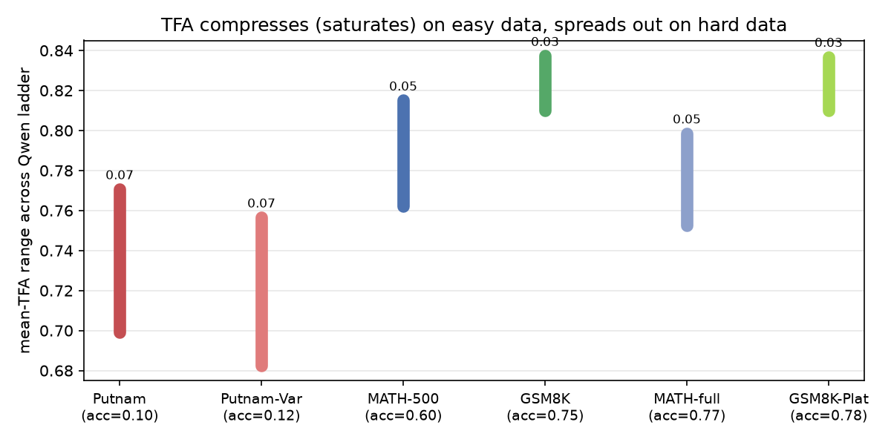
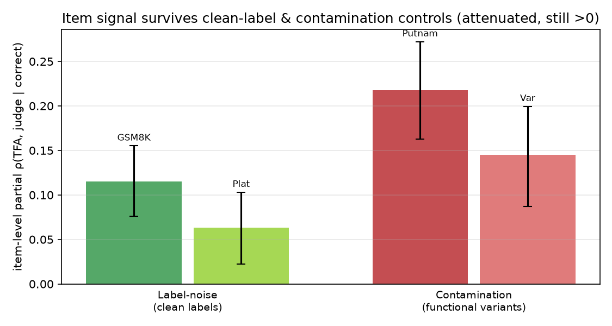

# When can a judge-free signal grade math reasoning?

*A study of Teacher-Forced Accuracy across GSM8K, MATH, and Putnam-AXIOM.*

**TL;DR.** Teacher-Forced Accuracy (TFA), the fraction of a reference solution's tokens a model would have predicted greedily, is often floated as a cheap, judge-free way to score reasoning. We test it against two frontier LLM judges on six math datasets and four model families. TFA ranks *models* almost perfectly within a family (and across families on hard data, though this ranking collapses on easy, saturated benchmarks), but it barely grades *individual solutions*: the per-item signal is statistically zero on MATH, small on GSM8K, and reaches only ρ≈0.22 on the hardest data (Putnam). That exception is real, it survives label-noise and contamination controls, but it is driven entirely by TFA having room to vary on hard problems, and it is far too weak to replace a judge. Code and data: [`experiments/tfa-vs-judge`](https://github.com/brando90/judge-free-eval/tree/main/experiments/tfa-vs-judge).

## The problem

Evaluating mathematical reasoning at scale is expensive. Checking a final answer is cheap but blind to the reasoning that produced it; grading the reasoning itself means paying a frontier LLM judge on every solution. A judge-free signal that tracks solution quality would make large evaluation loops such as reranking, filtering, and reward modeling dramatically cheaper.

Teacher-Forced Accuracy is the most natural candidate. Given a problem and a *gold* reference solution, we feed the reference to the model under teacher forcing and measure how often the model's greedy next-token prediction matches the reference token. A model that "would have written the gold solution" is presumably a strong reasoner. TFA needs no judge, no sampling, and one forward pass. Prior work has shown it ranks models well. The open question, and the one that decides whether TFA is useful as a grader rather than a leaderboard tool, is whether it can tell a *good* solution from a *bad* one on a *per-item* basis. That is what a judge does, and that is what we test.

## Setup

We evaluate the Qwen2.5 instruct ladder (0.5B, 1.5B, 3B, 7B, 14B) on six datasets spanning three difficulty regimes: grade-school word problems (**GSM8K**, and its relabeled **GSM8K-Platinum**), competition-style problems (**MATH-500** and a larger **MATH-full** algebra sample), and olympiad problems (**Putnam-AXIOM**, plus its **functional Variations** designed to defeat memorization). For each solution we record TFA and a ground-truth quality score from a gpt-5.2 judge (0–10), alongside final-answer correctness from Math-Verify. To check that our conclusions do not hinge on which judge defines quality, we additionally re-grade the three anchor datasets that span the difficulty regimes (MATH-500, GSM8K, and Putnam-AXIOM) with a second frontier judge from a different family (Claude Opus 4.8), using the identical rubric (see *§Is this one judge's opinion?*).

Our central question is whether TFA tracks judged quality *beyond* simply being correct. Correct answers score higher on both TFA and the judge, so a raw correlation is confounded. We therefore report the **partial Spearman correlation ρ(TFA, judge) controlling for correctness** (within the correct and incorrect solutions separately, does higher TFA mean a better-judged solution?), with 95% bootstrap confidence intervals, and we repeat every analysis controlling for solution length.

| dataset | n | accuracy | TFA range | model-level ρ(TFA, judge) | item-level ρ(TFA, judge \| correct) |
|---|---:|---:|:---:|:---:|:---:|
| MATH-500 | 2500 | 0.60 | 0.76–0.82 | +0.90 | −0.01 [−0.05, +0.04] |
| MATH-full | 2999 | 0.77 | 0.75–0.80 | +0.60 | +0.02 [−0.02, +0.05] |
| GSM8K | 2500 | 0.75 | 0.81–0.84 | +0.90 | +0.12 [+0.08, +0.16] |
| GSM8K-Platinum | 2500 | 0.78 | 0.81–0.84 | +0.70 | +0.06 [+0.02, +0.10] |
| Putnam-AXIOM | 1180 | 0.10 | 0.70–0.77 | +1.00 | **+0.22 [+0.16, +0.27]** |
| Putnam-Variations | 1325 | 0.12 | 0.68–0.76 | +1.00 | +0.15 [+0.09, +0.20] |

*All rows use the same five-model ladder. A 32B model was also run on MATH-500 and dropped here so the TFA ranges and model-level correlations are comparable across datasets.*

## What we found

**TFA is an excellent model ranker.** Averaged over a dataset, TFA orders the five models the same way accuracy and the judge do, with correlations from +0.60 to +1.00 (Figure 1). The correlation is strongest on the hardest data: on Putnam, mean TFA and mean judge score agree perfectly (ρ = +1.00). This inverts a natural worry, that TFA would be useless once models are weak, because weak models on hard problems are exactly where TFA has the most room to separate them. Where TFA weakens (down to +0.60) is the opposite regime: easy, near-saturated data where all five models look alike.

**But TFA barely grades individual solutions, and only on hard data.** The per-item picture (Figure 2) is a story of three dataset families, not a smooth trend. On MATH, both the standard 500-problem set and the larger algebra sample, the partial correlation is statistically indistinguishable from zero; TFA carries no information about which correct solution the judge prefers. On GSM8K it is small but real (+0.12). Only on Putnam does it become substantial (+0.22), and it stays positive under length control throughout. Even the best case is a weak correlate, not a grader: a ρ of 0.22 explains under 5% of the variance in judged quality.

**The pattern is explained by saturation, not accuracy.** Notice that GSM8K (75% accuracy) has a larger item-level signal than MATH-full (77% accuracy): difficulty as measured by accuracy is not what matters. What matters is how much room TFA has to move. On easy data all five models reproduce most gold tokens, so their mean TFA sits in a narrow 0.03-wide band (Figure 3); the metric is pinned near its ceiling and cannot discriminate. On Putnam the band widens to 0.07, and the per-item signal appears alongside it. TFA grades reasoning only where it is not saturated.

**The signal that does exist is genuine.** A skeptic could attribute the Putnam and GSM8K signal to memorized solutions or noisy gold labels rather than real reasoning quality. Two controls argue otherwise (Figure 4). Swapping Putnam for its functional variations, same structure, different numbers, contamination-proof, attenuates the signal from +0.22 to +0.15 but leaves it clearly above zero. Cleaning GSM8K's label noise with the Platinum relabeling halves it from +0.12 to +0.06, again staying positive. Both controls chip at the effect without erasing it, so what TFA measures on these datasets is competence, not an artifact.

## Is this one judge's opinion? A second judge agrees

Every number so far is measured against a single gpt-5.2 judge, and a judge-free metric validated against one *unvalidated* judge invites the obvious charge of circularity, most sharply for the *positive* item-level signals on GSM8K and Putnam, the paper's only non-null per-item results. To answer it we re-graded the three anchor datasets that span the difficulty regimes, MATH-500, GSM8K, and Putnam-AXIOM, with a second frontier judge from a different family (Claude Opus 4.8), same rubric, and re-ran the analysis.

The entire picture is judge-invariant. TFA ranks the five models the same way under both judges (model-level ρ ≥ +0.90 on every dataset), the MATH null stays null (item-level partial ρ ≈ 0 under both), and, the part that actually needed defending, **both positive signals replicate**: +0.12 → +0.10 on GSM8K and +0.22 → +0.16 on Putnam, with the second judge's confidence intervals still excluding zero. The difficulty gradient itself, zero on MATH, small on GSM8K, largest on Putnam, is reproduced by a judge that never saw the first judge's scores. The two judges also agree directly, item-level Spearman ρ from 0.75 (Putnam) to 0.94 (MATH), with 93–95% of scores within one point.

| anchor dataset | inter-judge ρ (all / within-correct) | model-level ρ(mean-TFA, judge) gpt-5.2 / Opus 4.8 | item-level ρ(TFA, judge \| correct) gpt-5.2 / Opus 4.8 |
|---|:---:|:---:|:---:|
| MATH-500 | 0.94 / 0.69 | +0.90 / +0.90 | −0.01 [−0.05,+0.04] / −0.01 [−0.05,+0.03] |
| GSM8K | 0.84 / 0.43 | +0.90 / +0.70 | +0.12 [+0.08,+0.16] / +0.10 [+0.06,+0.14] |
| Putnam-AXIOM | 0.75 / 0.86 | +1.00 / +1.00 | +0.22 [+0.16,+0.27] / +0.16 [+0.11,+0.22] |

*Five-model ladder, correctness from the fixed Math-Verify scorer as in the main table; the gpt-5.2 column reproduces it. Opus 4.8 graded 94.5% of GSM8K and ≥99.7% of the others, a handful of missing-at-random rate-limit dropouts.*

The second judge is uniformly a touch more conservative: its positive signals sit slightly below gpt-5.2's, and the two judges agree least on GSM8K's *correct* stratum (within-correct ρ = 0.43), where quality differences among short grade-school solutions are subtle. But no sign flips, no ordering changes, and no significant signal becomes insignificant. The judge-free conclusions here are properties of TFA, not of the particular frontier model we appointed as ground truth.

## Does this hold beyond one model family?

The second question is whether the results are idiosyncratic to Qwen2.5. Because TFA is a statistic of a model's own tokenizer and log-probabilities, family-specificity is a live worry. We added three other instruction-tuned families with distinct tokenizers (Mistral-7B, Phi-4 at 14B, and OLMo-2-13B) and re-ran the three anchor datasets.

Model-level ranking splits along the same saturation line that governs the item-level signal (Figure 6). On the harder, unsaturated datasets it generalizes cleanly: pooling all four families, mean-TFA still tracks the judge at ρ = +0.90 on MATH-500 and +0.88 on Putnam, barely below the within-Qwen +0.94 and +1.00. On saturated GSM8K it breaks, the cross-family correlation collapses to −0.07, down from +0.90 within Qwen. The scatter shows why: on GSM8K every model's TFA is pinned in a narrow 0.79–0.84 band, and each family sits at its own offset inside it. Mistral reproduces gold tokens as fluently as anyone (TFA 0.80) while solving far less (judge 6.6 versus Phi-4's 9.7), so ranking families by raw TFA scrambles them. TFA measures how predictable the reference is under a given model, and that predictability carries a family-specific baseline that stays negligible only when the data is hard enough to spread the models apart.

The item-level picture is family-robust where it was zero and family-dependent where it was positive. The MATH null reproduces for every family (partial ρ from −0.01 to −0.14, none positive). The small GSM8K signal appears in Qwen (+0.115) and Mistral (+0.103) but vanishes in Phi-4 and OLMo, which are accuracy-saturated on GSM8K (94% and 91%), leaving no spread among correct answers for TFA to grade. The Putnam signal is strong in Qwen (+0.22) but cannot be confirmed in the new families, whose correct strata are too small (3 to 19 percent accuracy) to estimate. Nothing here contradicts the paper's conclusions in another family, but the positive item-level signals need both an unsaturated dataset and a model with enough correct-but-varied solutions to grade, conditions the Qwen ladder happens to meet best.

## Why the ranking collapses on GSM8K, and not elsewhere

The collapse deserves a direct explanation, because it is not simply noise from a saturated metric. The two strongest models on GSM8K, Phi-4 and OLMo-2, earn the highest judge scores (9.7 and 9.3) yet produce the lowest teacher-forced accuracy on the reference (0.791 and 0.793). Mistral shows the opposite pattern: the highest teacher-forced accuracy among the new families (0.800) paired with the lowest judge score (6.6). Across families, higher agreement with the reference goes with lower solution quality, the reverse of what the metric should capture.

Two mechanical explanations can be ruled out with signals already in the data. If the effect came from the calculator annotations and formatting in the reference (expressions such as `<<3*3=9>>` and the `####` marker), then scoring only content tokens would recover the correlation. It does not: the content-token variant returns the same value on GSM8K. If the effect came from tokenizer granularity, since teacher-forced accuracy is a per-token rate and families split numbers and operators differently, then a per-character measure would recover it. Bits-per-character does not recover it either, and is slightly worse. On MATH-500 and Putnam all three variants agree near +0.85, so the failure is specific to GSM8K rather than to any particular way of counting tokens.

| cross-family ρ(signal, judge) | MATH-500 | GSM8K | Putnam |
|---|---:|---:|---:|
| teacher-forced accuracy (all tokens) | +0.86 | −0.07 | +0.88 |
| teacher-forced accuracy (content tokens) | +0.88 | −0.07 | +0.81 |
| negative bits-per-character | +0.83 | −0.21 | +0.83 |

What remains is the reasoning text itself. GSM8K reference solutions are short and written in a compressed, dataset-specific style. A representative gold solution reads, in full, "He sprints 3\*3=<<3\*3=9>>9 times. So he runs 9\*60=<<9\*60=540>>540 meters. #### 540." Phi-4 answers the same problem correctly but in a different register, with labeled steps and complete sentences. Teacher-forced on the terse reference, Phi-4 assigns lower probability to that phrasing, not because it cannot solve the problem, but because it would have written the solution another way. Qwen models are far more verbose than the reference in free generation, one of them by more than a factor of ten, yet they still predict the reference well under teacher forcing. This is consistent with their training having made the GSM8K solution style familiar to them. Mistral shares that familiarity and scores high teacher-forced accuracy while solving far fewer problems correctly.

The magnitudes confirm that these baseline differences dominate the quality signal. Within a single model, the gap in teacher-forced accuracy between its well-judged and poorly-judged GSM8K solutions is small, between 0.006 and 0.025. The gap between models is larger: Phi-4 sits about 0.04 below Qwen-7B while scoring higher with the judge. The variation that would rank models by quality is buried under a family-level stylistic baseline that carries no quality information.

The contrast with MATH-500 and Putnam follows from the same account. Their reference solutions are longer and constrained by the mathematics, so the next token in a derivation is fixed mostly by the argument rather than by house style, and predicting it requires genuine competence. GSM8K references are short enough, and stylized enough, that agreement with them measures familiarity with the dataset's format more than reasoning ability. This is the paper's central limitation seen from a new angle: teacher-forced accuracy scores the predictability of a fixed reference, not the quality of the model's own reasoning, and a short canonical reference is where that gap becomes visible across whole models rather than across individual items.

The account makes a testable prediction. If stylistic distance from a single reference is the cause, then scoring each model against several valid solutions, or against its own verified solution, should remove the family baseline and restore the GSM8K ranking. That multi-reference test is the natural next step, and a positive result would also give a practical fix for cross-family use.

## A judge-free signal that *does* grade solutions, at a cost

If token agreement with a fixed reference cannot grade a solution, what can? We changed the object being measured. Rather than asking how well the model reproduces a gold trace, we ask whether the model's *own* partial reasoning stays on track toward a correct answer. Concretely, we truncate a response at several points (after 0%, 25%, 50%, and 75% of its tokens), hand each prefix to a fixed *completer* model, let it continue eight times, and record V(f), the fraction of continuations that reach the correct final answer, checked by the same symbolic oracle, still with no judge in the loop. A response whose prefixes keep the problem solvable was reasoning well; one that derails the completer was not. We summarize each response's value trajectory by its mean and its late value V(75%). This is Math-Shepherd-style *process value*, and it is deliberately not cheap: it costs many sampled completions per response rather than one teacher-forcing pass.

This signal clears the bar TFA never did. Controlling for correctness, the rollout value correlates with the judge at ρ = +0.33 to +0.43 across completers on 450 MATH-500 responses (150 problems × 3 models), the same MATH setting where TFA's own per-item signal was zero, with confidence intervals that exclude zero and that *strengthen* when we additionally control for problem difficulty, the opposite behavior of an artifact. And at the right completer it produces the first positive signal we found in the hardest regime of all: among *correct* answers, where every TFA variant sat at zero, the value separates genuinely-sound solutions from lucky ones at ρ = +0.19 [0.09, 0.29].

The completer's strength follows an inverted-U (Figure 5). Too weak (7B) and it fails to finish even good prefixes, adding noise; too strong (32B) and it re-solves the problem regardless of the prefix (it already solves 91% from scratch), washing the signal out. A mid-strength 14B completer is the sweet spot on both the overall correlation and the decisive within-correct test, and it is the only setting where the within-correct signal becomes significant.

| completer | base solve-rate V(0) | overall (partial ρ \| correct) | within-correct | within-wrong |
|---|:---:|:---:|:---:|:---:|
| 7B (too weak) | 0.82 | +0.33 [0.24, 0.41] | +0.09 [−0.02, 0.20] *(n.s.)* | +0.73 |
| **14B (sweet spot)** | 0.88 | **+0.43 [0.35, 0.51]** | **+0.19 [0.09, 0.29]** | +0.73 |
| 32B (too strong) | 0.91 | +0.37 [0.27, 0.45] | +0.08 [−0.02, 0.19] *(n.s.)* | +0.67 |

Two honest caveats. First, this is not TFA and not cheap: it costs eight completions at each of four cut-points, hundreds of times the cost of a single teacher-forcing pass, and it is stochastic. It is a process-reward model or soft verifier, not a drop-in judge replacement. Second, most of its signal lives in the *wrong* stratum (within-wrong ρ ≈ +0.7): it is very good at telling a near-miss from incoherent nonsense, which for math is a legitimate but largely *correctness-graded* notion of quality. The within-correct signal, the one that would truly rival a judge, is real but weak and fragile, appearing only at the sweet-spot completer.

## What this means

For *ranking models* without a judge, TFA works and we recommend it, with one caveat the cross-family experiment made concrete: rank models *within a family*, or across families only on hard, unsaturated data. It is one forward pass per solution, correlates near 1.0 with a frontier judge, and is best precisely where judging is hardest; but on an easy, saturated benchmark like GSM8K the raw score carries a family-specific offset that scrambles cross-family comparisons. For *grading individual solutions*, TFA is not a judge replacement. Its per-item signal is absent on the benchmarks people evaluate on most (MATH), and where it appears it is too weak to act on. The reason is structural: a gold-anchored teacher-forcing signal only informs when the gold is hard enough that models genuinely differ in reproducing it. The way forward is to measure the model's *own* reasoning rather than its agreement with a reference. The rollout process value does exactly that and does grade solutions, including, weakly, the coveted case of separating sound from lucky *correct* answers, but it buys that signal with hundreds of times the compute and remains a stochastic soft verifier, not a cheap deterministic judge. The open problem is closing the gap between TFA's price and the rollout value's signal: a per-item grader that is both cheap and informative under saturation. Anchoring on the model's own most-consistent solution instead of a fixed gold is one promising, still-untested route.

## Next steps

A companion study from our group on the judges themselves, *Rethinking LLM Judges* (Chen, Gulati, Miranda, Tang, Koyejo; ICLR 2026 Workshop), sharpens three directions. It matters here because every number in this paper is measured against a judge, and that study measures the judge against humans.

**Bound the item-level result by the judge's own reliability.** That work grades each solution five times and reports within-run variance alongside human agreement, on the premise that a noisy judge is a poor target no matter how strong its mean agreement looks. Our item-level correlations inherit the same ceiling: the two frontier judges agreed with *each other* only at ρ = 0.43–0.86 within the correct stratum (§Is this one judge's opinion?), so no judge-free signal can track "the judge" much above that bound. We will measure our judge's test–retest reliability directly and report the item-level correlations disattenuated by it; TFA is deterministic, so all the noise sits on the judge side. The MATH null should survive the correction, zero stays zero, but the exercise states the negative more honestly: TFA fails to grade individual solutions against a target that is itself only ρ ≈ 0.5–0.7 reliable.

**Validate against human grades, not just judges.** The same study releases Putnam-AXIOM-Grading, 500 human-graded solutions scored on a five-component analytic rubric with a second annotator (quadratic-weighted κ = 0.983), built on the same Putnam base we use. This is the human ground truth our Limitations calls the missing gold standard, and it makes two checks directly runnable: how well our LLM judge tracks the human grades (their best single-pass judge reaches ρ ≈ 0.87 on Putnam), and how well TFA tracks the human grades on the one dataset where its item-level signal is largest. The graded solutions come from a different model (Qwen2.5-72B-Math) than our ladder, so this is a calibration and transfer test, not a drop-in swap.

**Adopt the comparative judge as the default target.** That study finds the most human-aligned and most stable judge is a single-pass strategy that puts the reference in context and reasons holistically about candidate-versus-reference, beating multi-step pipelines at three-to-five times lower cost, while unconstrained chain-of-thought and mechanical subtask decomposition both degrade agreement. Our current rubric is already reference-grounded and holistic but allows only a one-sentence justification; moving to the comparative recipe is cheap and makes the two papers consistent. We flag it as method hygiene, not a fix: the same study shows strategy differences compress for frontier judges like ours, so we do not expect it to move the item-level story.

## Limitations

Ground truth is defined by frontier LLM judges rather than humans. We validate against two judge families, gpt-5.2 and Claude Opus 4.8, which agree closely (item-level ρ 0.75–0.94) and yield identical conclusions across all three anchor datasets, including the positive signals; but human ratings remain the missing gold standard, and two LLM judges could still share a blind spot. The core study uses the Qwen2.5 ladder; we test generalization with three further families (Mistral, Phi-4, OLMo-2), but only one model each and only at 7–14B, so the positive item-level signals could be confirmed only where a family had enough correct, unsaturated solutions to grade, in practice Qwen. MATH-full samples only the algebra subject. Putnam's correct-answer stratum is small (≈10% accuracy), so the robust part of its item-level signal comes from the incorrect solutions; final-answer correctness there relies on Math-Verify, which produces false positives on complex expressions. The GSM8K-versus-Platinum comparison uses overlapping but not identical items, so it is directional rather than a paired ablation.

## Reproducibility

Raw rollouts, per-token argmax/log-probability records, and seeds are saved under `/dfs/scratch0/srivatsavad/jfe_raw/`. All numbers regenerate from the committed per-item scores (`runs/scores_*.jsonl`) via `scripts/analyze_workstream_a2.py` and `scripts/make_figures.py`, which write `paper/summary.json` and the figures above. Full method notes and bug post-mortems are in [`JOURNAL.md`](../JOURNAL.md) §4b. Next directions we consider most promising, process-reward signals that survive saturation, cross-family judges, and self-reference (grading against the model's own solution rather than a fixed gold), are laid out in the [research brief](../../../docs/fable-weekend-research-brief.md).

## Appendix: cheap TFA variants we tried to recover an item-level signal

Before adopting the expensive rollout value, we tried to squeeze a per-item signal out of gold-token agreement while keeping TFA's single-forward-pass cost, by reweighting which tokens count, or by contrasting the gold against a corrupted version. All seven failed. We record them here so others do not repeat them; the pattern is that reweighting the same gold-prediction cannot create a signal that is simply absent.

| variant | idea | item-level ρ (partial \| correct) | outcome |
|---|---|:---:|---|
| content-token TFA | mask formatting/LaTeX glue, score content tokens only | ~0 | null persists, not a formatting artifact |
| TFA-logprob / BPC | soft gold-token log-probability instead of argmax match | ~0 (−0.11 within-correct) | soft variant no better |
| surprisal-weighted TFA | up-weight surprising (non-formulaic) gold tokens | −0.16 | *worse*, surprising tokens are the hard ones good models also miss |
| IDF-weighted TFA | up-weight corpus-rare gold tokens | −0.01 | ≈ baseline, reweighting frequency adds nothing |
| contrastive TFA (answer-swap) | TFA(gold) − TFA(gold with a wrong final answer) | +0.18 → −0.02 | **artifact, retracted** (see below) |
| contrastive TFA (step-shuffle) | TFA(gold) − TFA(gold with reasoning lines reordered) | −0.13 | fails, next-token prediction is local, blind to global step order |
| multi-reference TFA | max TFA over K verified gold solutions | not run | expected to fix only the alternate-path half of the null |

**The cautionary tale that changed how we work.** The answer-swap contrast first looked like a genuine win at ρ ≈ +0.35. It was a `1/gold_length` artifact: because the corruption changes only the final answer token, the contrast reduces to roughly "predicts the correct answer, divided by solution length," and inverse gold-length (Spearman +0.67 with the contrast) re-imported the very length confound TFA already suffers from, this time with a flattering sign. Stripping the length magnitude dropped it to +0.01; controlling for correctness *and* length drove it to −0.02. We retracted it. The lesson is now a rule: **no positive item-level result is believed until it survives controlling for its plausible confounds, length and difficulty.** The rollout value in the main text passes that test (it strengthens under difficulty control); these TFA variants do not.

The deeper takeaway from this appendix is that the failure is not a hidden confound one can reweight away, the item-level signal is genuinely absent under gold-prediction. Recovering it requires changing *what is measured*, which is exactly what the rollout process value does.
