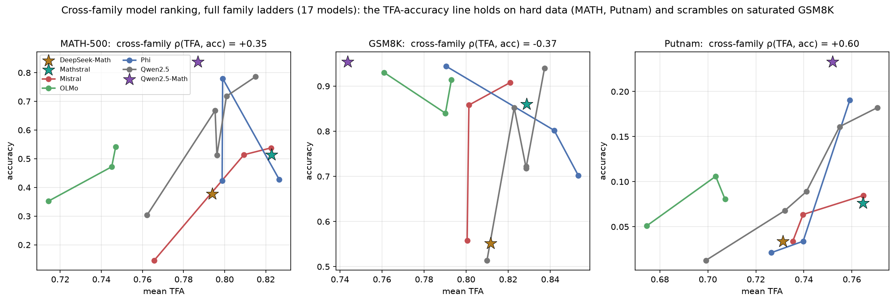
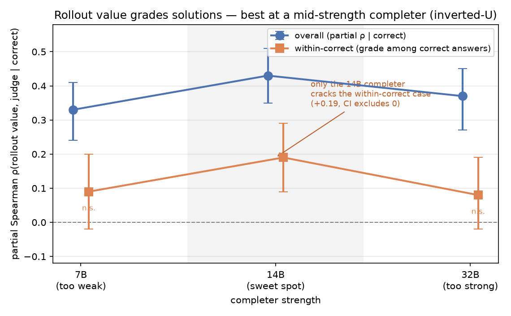

# When can a judge-free signal grade math reasoning?

*When a cheap, judge-free signal can rank models and grade reasoning, and when it cannot. Across 17 models, 7 families, 8 datasets (math, olympiad, code), and 2 frontier judges.*

**TL;DR.** Teacher-Forced Accuracy (TFA) measures how well a model would have written a gold reference solution token by token. It is a cheap, judge-free, single-forward-pass number, and it is often floated as a way to score reasoning. Our headline finding is that **TFA measures agreement with the reference's style, not reasoning quality**, and everything else follows from that. As a *model ranker* it is excellent within a single model family and on hard, tightly-constrained references, but it breaks across families on easy or stylized data (GSM8K) and on code, where a task has many valid solutions. As a *per-solution grader* it essentially fails: the signal beyond mere correctness is statistically zero on MATH and reaches only ρ≈0.22 on the hardest math. We reproduce the original TFA paper's headline 0.66 correlation and show it is a metric-and-model-set effect (math-specialized models are the outliers). And we show that a much more expensive rollout-based *process* signal does grade individual solutions where TFA cannot, weakly. Code and data: [`experiments/tfa-vs-judge`](https://github.com/brando90/judge-free-eval/tree/main/experiments/tfa-vs-judge).

## Results at a glance

- **Model ranking, within a family: TFA works.** It ranks the Qwen ladder by quality at ρ = +0.6 to +1.0 on every dataset, and the Mistral ladder at +1.0.
- **Model ranking, across families: a boundary map, not a yes/no.** It holds on hard, constrained math (Putnam +0.88), collapses on easy saturated data (GSM8K −0.07), and collapses on code (+0.11), where solution multiplicity is high. Math-specialized models and Mistral are the outliers that break it.
- **Within-family ranking is not even universal.** Mistral and Qwen rank cleanly, but Phi and OLMo *invert* on easy data (Phi Pearson −0.97 on GSM8K): their stronger models drift from the terse reference style.
- **Grading individual solutions: TFA cannot.** Beyond the correctness it shares with a free answer-check, the per-item signal is ≈0 on MATH, small on GSM8K (+0.12), and only +0.22 on Putnam, too weak to replace a judge. What signal exists is genuine (survives label-noise and contamination controls) and comes entirely from TFA de-saturating on hard problems.
- **The mechanism, made precise.** Write per-item TFA as competence + a reference-predictability nuisance. The nuisance is 86–96% of the within-model variance and the competence term is indistinguishable from zero, so grading fails. But the nuisance is a property of the reference and is constant across models, so it vanishes when you average over items, which is why model-level ranking works and item-level grading does not.
- **Judge-invariant.** Two frontier judges from different families (gpt-5.2, Claude Opus 4.8) give the same conclusions; TFA is not tuned to one judge.
- **Reconciled with the original TFA paper.** Their 0.66 (MATH) and 0.52 (Putnam) match our numbers once the correlation metric (Kendall) and the model set (math-specialized outliers) are matched. Their untested item-level claim does not hold.
- **Olympiad extreme (Omni-MATH).** Even where accuracy is floored at 2–6%, TFA still ranks models (+0.86) and its range widens further, so the "weak-model floor" worry is inverted at the hardest end.
- **What does grade solutions.** A rollout process value (truncate a response, let a fixed completer finish it, score reaching the correct answer) grades items at ρ = +0.43 and even separates sound-from-lucky *correct* answers at +0.19, but only at a mid-strength completer and at ~100× the cost, so it is a soft verifier, not a cheap judge.

## The problem

Evaluating mathematical reasoning at scale is expensive. Checking a final answer is cheap but blind to the reasoning that produced it; grading the reasoning itself means paying a frontier LLM judge on every solution. A judge-free signal that tracks solution quality would make large evaluation loops such as reranking, filtering, and reward modeling dramatically cheaper.

Teacher-Forced Accuracy is the most natural candidate. Given a problem and a *gold* reference solution, we feed the reference to the model under teacher forcing and measure how often the model's greedy next-token prediction matches the reference token. A model that "would have written the gold solution" is presumably a strong reasoner. TFA needs no judge, no sampling, and one forward pass. Prior work has shown it ranks models well. The open question, and the one that decides whether TFA is useful as a grader rather than a leaderboard tool, is whether it can tell a *good* solution from a *bad* one on a *per-item* basis. That is what a judge does, and that is what we test.

## Setup

We evaluate the Qwen2.5 instruct ladder (0.5B, 1.5B, 3B, 7B, 14B) on six datasets spanning three difficulty regimes: grade-school word problems (**GSM8K**, and its relabeled **GSM8K-Platinum**), competition-style problems (**MATH-500** and a larger **MATH-full** algebra sample), and olympiad problems (**Putnam-AXIOM**, plus its **functional Variations** designed to defeat memorization). For each solution we record TFA and a ground-truth quality score from a gpt-5.2 judge (0–10), alongside final-answer correctness from Math-Verify. To check that our conclusions do not hinge on which judge defines quality, we additionally re-grade the three anchor datasets that span the difficulty regimes (MATH-500, GSM8K, and Putnam-AXIOM) with a second frontier judge from a different family (Claude Opus 4.8), using the identical rubric (see *§Is this one judge's opinion?*).

This Qwen ladder is the core study, and the body of the paper works through it. We then widen the lens: twelve further models in six more families (Mistral, Phi, OLMo, and the math-specialized Qwen2.5-Math, DeepSeek-Math, Mathstral) to test cross-family and within-family generalization; an olympiad set (Omni-MATH) and a code benchmark (HumanEval, scored by its own unit tests) to map where TFA transfers; and a rollout-based process value as a costlier alternative that actually grades solutions. Seventeen models, seven families, and eight datasets in all. Each extension has its own section or appendix, flagged where it comes up.

Our central question is whether TFA tracks judged quality *beyond* simply being correct. Correct answers score higher on both TFA and the judge, so a raw correlation is confounded. We therefore report the **partial Spearman correlation ρ(TFA, judge) controlling for correctness** (within the correct and incorrect solutions separately, does higher TFA mean a better-judged solution?), with 95% bootstrap confidence intervals, and we repeat every analysis controlling for solution length.

| dataset | n | accuracy | TFA range | model-level ρ(TFA, accuracy) | model-level ρ(TFA, judge) | item-level ρ(TFA, judge \| correct) |
|---|---:|---:|:---:|:---:|:---:|:---:|
| MATH-500 | 2500 | 0.60 | 0.76–0.82 | +0.90 | +0.90 | −0.01 [−0.05, +0.04] |
| MATH-full | 2999 | 0.77 | 0.75–0.80 | +0.60 | +0.60 | +0.02 [−0.02, +0.05] |
| GSM8K | 2500 | 0.75 | 0.81–0.84 | +0.70 | +0.90 | +0.12 [+0.08, +0.16] |
| GSM8K-Platinum | 2500 | 0.78 | 0.81–0.84 | +0.60 | +0.70 | +0.06 [+0.02, +0.10] |
| Putnam-AXIOM | 1180 | 0.10 | 0.70–0.77 | +1.00 | +1.00 | **+0.22 [+0.16, +0.27]** |
| Putnam-Variations | 1325 | 0.12 | 0.68–0.76 | +0.90 | +1.00 | +0.15 [+0.09, +0.20] |

*All rows use the same five-model Qwen2.5 ladder, Spearman correlation. A 32B model was also run on MATH-500 and dropped here so the TFA ranges and model-level correlations are comparable across datasets. Accuracy and judge correlations agree closely at the model level; where they differ, judge is higher on the easy sets (GSM8K, Platinum) where accuracy is near-saturated. A full breakdown across model families and correlation metrics (Pearson, Spearman, Kendall, ICC) is in the appendix.*

## What we found

**TFA is an excellent model ranker.** Averaged over a dataset, TFA orders the five models the same way accuracy and the judge do, with correlations from +0.60 to +1.00 (Figure 1). The correlation is strongest on the hardest data: on Putnam, mean TFA and mean judge score agree perfectly (ρ = +1.00). This inverts a natural worry, that TFA would be useless once models are weak, because weak models on hard problems are exactly where TFA has the most room to separate them. Where TFA weakens (down to +0.60) is the opposite regime: easy, near-saturated data where all five models look alike.

**But TFA barely grades individual solutions, and only on hard data.** The per-item picture (Figure 2) is a story of three dataset families, not a smooth trend. On MATH, both the standard 500-problem set and the larger algebra sample, the partial correlation is statistically indistinguishable from zero; TFA carries no information about which correct solution the judge prefers. On GSM8K it is small but real (+0.12). Only on Putnam does it become substantial (+0.22), and it stays positive under length control throughout. Even the best case is a weak correlate, not a grader: a ρ of 0.22 explains under 5% of the variance in judged quality.

**The pattern is explained by saturation, not accuracy.** Notice that GSM8K (75% accuracy) has a larger item-level signal than MATH-full (77% accuracy): difficulty as measured by accuracy is not what matters. What matters is how much room TFA has to move. On easy data all five models reproduce most gold tokens, so their mean TFA sits in a narrow 0.03-wide band (Figure 3); the metric is pinned near its ceiling and cannot discriminate. On Putnam the band widens to 0.07, and the per-item signal appears alongside it. TFA grades reasoning only where it is not saturated.

**The signal that does exist is genuine.** A skeptic could attribute the Putnam and GSM8K signal to memorized solutions or noisy gold labels rather than real reasoning quality. Two controls argue otherwise (Figure 4). Swapping Putnam for its functional variations, same structure, different numbers, contamination-proof, attenuates the signal from +0.22 to +0.15 but leaves it clearly above zero. Cleaning GSM8K's label noise with the Platinum relabeling halves it from +0.12 to +0.06, again staying positive. Both controls chip at the effect without erasing it, so what TFA measures on these datasets is competence, not an artifact.

## Is this one judge's opinion? A second judge agrees

Every number so far is measured against a single gpt-5.2 judge, and a judge-free metric validated against one *unvalidated* judge invites the obvious charge of circularity, most sharply for the *positive* item-level signals on GSM8K and Putnam, the paper's only non-null per-item results. To answer it we re-graded the three anchor datasets that span the difficulty regimes, MATH-500, GSM8K, and Putnam-AXIOM, with a second frontier judge from a different family (Claude Opus 4.8), same rubric, and re-ran the analysis.

The entire picture is judge-invariant. TFA ranks the five models the same way under both judges (model-level ρ ≥ +0.90 on every dataset), the MATH null stays null (item-level partial ρ ≈ 0 under both), and, the part that actually needed defending, **both positive signals replicate**: +0.12 → +0.10 on GSM8K and +0.22 → +0.16 on Putnam, with the second judge's confidence intervals still excluding zero. The difficulty gradient itself, zero on MATH, small on GSM8K, largest on Putnam, is reproduced by a judge that never saw the first judge's scores. The two judges also agree directly, item-level Spearman ρ from 0.75 (Putnam) to 0.94 (MATH), with 93–95% of scores within one point.

| anchor dataset | inter-judge ρ (all / within-correct) | model-level ρ(mean-TFA, judge) gpt-5.2 / Opus 4.8 | item-level ρ(TFA, judge \| correct) gpt-5.2 / Opus 4.8 |
|---|:---:|:---:|:---:|
| MATH-500 | 0.94 / 0.69 | +0.90 / +0.90 | −0.01 [−0.05,+0.04] / −0.01 [−0.05,+0.03] |
| GSM8K | 0.84 / 0.43 | +0.90 / +0.70 | +0.12 [+0.08,+0.16] / +0.10 [+0.06,+0.14] |
| Putnam-AXIOM | 0.75 / 0.86 | +1.00 / +1.00 | +0.22 [+0.16,+0.27] / +0.16 [+0.11,+0.22] |

*Five-model ladder, correctness from the fixed Math-Verify scorer as in the main table; the gpt-5.2 column reproduces it. Opus 4.8 graded 94.5% of GSM8K and ≥99.7% of the others, a handful of missing-at-random rate-limit dropouts.*

The second judge is uniformly a touch more conservative: its positive signals sit slightly below gpt-5.2's, and the two judges agree least on GSM8K's *correct* stratum (within-correct ρ = 0.43), where quality differences among short grade-school solutions are subtle. But no sign flips, no ordering changes, and no significant signal becomes insignificant. The judge-free conclusions here are properties of TFA, not of the particular frontier model we appointed as ground truth.

## Does model ranking generalize? A boundary set by the reference

TFA ranks the Qwen ladder well; the question is whether that survives beyond one model family. Because TFA is a statistic of a model's own tokenizer and log-probabilities, family-specificity is a live worry, so we ran the full sweep behind this paper: seventeen models in seven families, with size ladders for Mistral (7B, Ministral-8B, Small-22B), Phi (3.5-mini, 3-medium, Phi-4), and OLMo-2 (7B, 13B, 32B), and three math-specialized models (Qwen2.5-Math, DeepSeek-Math, Mathstral), alongside the Qwen ladder, on the six math datasets plus an olympiad set (Omni-MATH) and a code benchmark (HumanEval). The answer is not yes or no but a boundary, and the boundary is set by how constrained the reference is and whether the models share its style (Figure 6).

**Within a family, TFA ranks, but not always.** It ranks the Qwen ladder (+0.6 to +1.0) and the Mistral ladder (+1.0) cleanly on every dataset. But Phi and OLMo invert on the easy, saturated sets: on GSM8K the better Phi models have the lower TFA (Pearson −0.97), because their stronger members answer in an increasingly non-reference style and predict the terse gold worse even as they solve more. Even the within-family guarantee holds only when a family's models share a stable style close to the reference. The full within-family table is in the appendix.

**Across families, it holds on hard references and collapses on easy ones.** Pooling all seventeen models, mean-TFA ranks by accuracy on the hard, constrained references (MATH-500 +0.35, Putnam +0.60) but goes negative on the saturated GSM8K sets (−0.37). On GSM8K every model's TFA is pinned into a narrow 0.79 to 0.84 band, and each family sits at its own offset inside it, so the ranking scrambles. Restricting to the four general families, before the math-specialized models come in below, the same split is sharper: +0.86 on MATH and +0.88 on Putnam, but −0.07 on GSM8K.

**Why GSM8K, and not the others.** The collapse is not saturation noise; it has a mechanism. On GSM8K the two strongest models, Phi-4 and OLMo-2, solve the most (94 and 91 percent) yet have the lowest TFA on the reference (0.79), while Mistral has the highest TFA (0.80) and solves the least (56 percent). Higher agreement with the reference goes with lower quality, the reverse of what the metric should capture. Two mechanical explanations fail: scoring only content tokens returns the same correlation, and a per-character bits measure is if anything worse, so it is neither the calculator-markup formatting (expressions such as `<<3*3=9>>` and the `####` marker) nor tokenizer granularity. What remains is the reasoning text itself. GSM8K references are short and written in a compressed, dataset-specific style, a full solution reading "He sprints 3\*3=<<3\*3=9>>9 times. So he runs 9\*60=<<9\*60=540>>540 meters. #### 540." Phi-4 solves the same problem correctly but in labeled prose, so teacher-forced on the terse reference it predicts that phrasing poorly, not because it cannot solve the problem but because it would have written the solution another way. Qwen and Mistral predict the GSM8K style well, consistent with training exposure to it. The style gap between models, about 0.04 in TFA, dwarfs the within-model quality gap of 0.006 to 0.025, so on a short reference the family-level style baseline buries the quality signal. MATH and Putnam references are longer and constrained by the mathematics, so the next token is fixed by the argument rather than by house style, and the ranking survives.

**Math-specialized models are the sharpest case, and they reconcile the original TFA paper.** The clearest off-line models are the math-tuned ones. DeepSeek-Math solves 38 percent of MATH but reproduces the gold at 0.79; Mathstral solves 51 percent at 0.82. Trained on MATH-style solutions, they predict the reference beyond their ability to solve it. Qwen2.5-Math is the mirror image, solving 84 percent but predicting the verbose gold at only 0.79 in its own concise style. This resolves an apparent disagreement with the paper that introduced TFA, which reports its correlation with accuracy as 0.66 on MATH across fifteen models and 0.52 on Putnam (rising to 0.62 once two outliers are dropped), below our within-Qwen +0.90 and +1.00. Two choices reconcile the numbers. First the metric: Kendall tau, the honest choice for ranking a handful of models, turns our pooled Spearman +0.86 on MATH into +0.64, which is their 0.66. Second the model set: adding the math-specialized models drops the pooled correlation, and their "0.62 without two outliers" on Putnam is exactly the lift we get by removing them.

| model-level TFA vs boxed accuracy | Pearson | Spearman | Kendall | ICC |
|---|---:|---:|---:|---:|
| MATH-500, all 11 models (with math-specialized) | +0.54 | +0.55 | +0.38 | +0.56 |
| MATH-500, general families only (drop math-specialized) | +0.77 | +0.86 | +0.64 | +0.79 |
| Putnam, all 11 models (with math-specialized) | +0.68 | +0.68 | +0.51 | +0.70 |
| Putnam, general families only | +0.85 | +0.88 | +0.71 | +0.86 |

The model-level result reproduces once metric and model set are matched. Their one untested claim, that TFA gives step-level insight into individual solutions and penalizes a right answer reached by wrong reasoning, does not hold: they never checked it against a judge or against people, and our item-level analysis shows it is absent on MATH.

**At the olympiad extreme, TFA gets sharper.** On Omni-MATH accuracy is floored at 2 to 6 percent, yet TFA still ranks the seven models we could run (+0.86 pooled, +0.90 within Qwen) and its range widens to the largest of any dataset. Harder data gives TFA more room, so the worry that it fails once models are weak is inverted, not confirmed.

**On code, it breaks.** Code has many valid solutions, so one gold reference penalizes correct-but-different programs. Teacher-forcing TFA on the canonical HumanEval solution and scoring free-generation pass@1 by the unit tests, the cross-family correlation collapses to +0.11 while the within-Qwen ladder holds at +0.80. Mistral-7B has the highest TFA on the reference code and nearly the lowest pass@1: it reproduces the reference style and writes code that does not pass.

**One boundary, and its item-level shadow.** All of these are the same fact. TFA ranks models by how well they reproduce a reference's style, which coincides with quality when the reference is a tightly-constrained trace and the models share its style, and diverges from quality otherwise. Judge-free model ranking with TFA is safe within a family, and across families only on hard, constrained references; on easy or stylized references, on code, and a fortiori on reference-free agentic tasks, it needs a different signal. The item-level null generalizes the same way: the MATH per-item signal stays about zero in every family, and the small GSM8K item-signal appears only in the families that predict the reference style well (Qwen +0.115, Mistral +0.103), vanishing in the accuracy-saturated Phi and OLMo whose correct answers leave TFA no room to vary.

## A judge-free signal that *does* grade solutions, at a cost

If token agreement with a fixed reference cannot grade a solution, what can? We changed the object being measured. Rather than asking how well the model reproduces a gold trace, we ask whether the model's *own* partial reasoning stays on track toward a correct answer. Concretely, we truncate a response at several points (after 0%, 25%, 50%, and 75% of its tokens), hand each prefix to a fixed *completer* model, let it continue eight times, and record V(f), the fraction of continuations that reach the correct final answer, checked by the same symbolic oracle, still with no judge in the loop. A response whose prefixes keep the problem solvable was reasoning well; one that derails the completer was not. We summarize each response's value trajectory by its mean and its late value V(75%). This is Math-Shepherd-style *process value*, and it is deliberately not cheap: it costs many sampled completions per response rather than one teacher-forcing pass.

This signal clears the bar TFA never did. Controlling for correctness, the rollout value correlates with the judge at ρ = +0.33 to +0.43 across completers on 450 MATH-500 responses (150 problems × 3 models), the same MATH setting where TFA's own per-item signal was zero, with confidence intervals that exclude zero and that *strengthen* when we additionally control for problem difficulty, the opposite behavior of an artifact. And at the right completer it produces the first positive signal we found in the hardest regime of all: among *correct* answers, where every TFA variant sat at zero, the value separates genuinely-sound solutions from lucky ones at ρ = +0.19 [0.09, 0.29].

The completer's strength follows an inverted-U (Figure 5). Too weak (7B) and it fails to finish even good prefixes, adding noise; too strong (32B) and it re-solves the problem regardless of the prefix (it already solves 91% from scratch), washing the signal out. A mid-strength 14B completer is the sweet spot on both the overall correlation and the decisive within-correct test, and it is the only setting where the within-correct signal becomes significant.

| completer | base solve-rate V(0) | overall (partial ρ \| correct) | within-correct | within-wrong |
|---|:---:|:---:|:---:|:---:|
| 7B (too weak) | 0.82 | +0.33 [0.24, 0.41] | +0.09 [−0.02, 0.20] *(n.s.)* | +0.73 |
| **14B (sweet spot)** | 0.88 | **+0.43 [0.35, 0.51]** | **+0.19 [0.09, 0.29]** | +0.73 |
| 32B (too strong) | 0.91 | +0.37 [0.27, 0.45] | +0.08 [−0.02, 0.19] *(n.s.)* | +0.67 |

Two honest caveats. First, this is not TFA and not cheap: it costs eight completions at each of four cut-points, hundreds of times the cost of a single teacher-forcing pass, and it is stochastic. It is a process-reward model or soft verifier, not a drop-in judge replacement. Second, most of its signal lives in the *wrong* stratum (within-wrong ρ ≈ +0.7): it is very good at telling a near-miss from incoherent nonsense, which for math is a legitimate but largely *correctness-graded* notion of quality. The within-correct signal, the one that would truly rival a judge, is real but weak and fragile, appearing only at the sweet-spot completer.

## What this means

For *ranking models* without a judge, TFA works and we recommend it, with one caveat the cross-family experiment made concrete: rank models *within a family*, or across families only on hard, unsaturated data. It is one forward pass per solution, correlates near 1.0 with a frontier judge, and is best precisely where judging is hardest; but on an easy, saturated benchmark like GSM8K the raw score carries a family-specific offset that scrambles cross-family comparisons. For *grading individual solutions*, TFA is not a judge replacement. Its per-item signal is absent on the benchmarks people evaluate on most (MATH), and where it appears it is too weak to act on. The reason is structural: a gold-anchored teacher-forcing signal only informs when the gold is hard enough that models genuinely differ in reproducing it. The way forward is to measure the model's *own* reasoning rather than its agreement with a reference. The rollout process value does exactly that and does grade solutions, including, weakly, the coveted case of separating sound from lucky *correct* answers, but it buys that signal with hundreds of times the compute and remains a stochastic soft verifier, not a cheap deterministic judge. The open problem is closing the gap between TFA's price and the rollout value's signal: a per-item grader that is both cheap and informative under saturation. Anchoring on the model's own most-consistent solution instead of a fixed gold is one promising, still-untested route.

## Next steps

A companion study from our group on the judges themselves, *Rethinking LLM Judges* (Chen, Gulati, Miranda, Tang, Koyejo; ICLR 2026 Workshop), sharpens three directions. It matters here because every number in this paper is measured against a judge, and that study measures the judge against humans.

**Bound the item-level result by the judge's own reliability.** That work grades each solution five times and reports within-run variance alongside human agreement, on the premise that a noisy judge is a poor target no matter how strong its mean agreement looks. Our item-level correlations inherit the same ceiling: the two frontier judges agreed with *each other* only at ρ = 0.43–0.86 within the correct stratum (§Is this one judge's opinion?), so no judge-free signal can track "the judge" much above that bound. We will measure our judge's test–retest reliability directly and report the item-level correlations disattenuated by it; TFA is deterministic, so all the noise sits on the judge side. The MATH null should survive the correction, zero stays zero, but the exercise states the negative more honestly: TFA fails to grade individual solutions against a target that is itself only ρ ≈ 0.5–0.7 reliable.

**Validate against human grades, not just judges.** The same study releases Putnam-AXIOM-Grading, 500 human-graded solutions scored on a five-component analytic rubric with a second annotator (quadratic-weighted κ = 0.983), built on the same Putnam base we use. This is the human ground truth our Limitations calls the missing gold standard, and it makes two checks directly runnable: how well our LLM judge tracks the human grades (their best single-pass judge reaches ρ ≈ 0.87 on Putnam), and how well TFA tracks the human grades on the one dataset where its item-level signal is largest. The graded solutions come from a different model (Qwen2.5-72B-Math) than our ladder, so this is a calibration and transfer test, not a drop-in swap.

**Adopt the comparative judge as the default target.** That study finds the most human-aligned and most stable judge is a single-pass strategy that puts the reference in context and reasons holistically about candidate-versus-reference, beating multi-step pipelines at three-to-five times lower cost, while unconstrained chain-of-thought and mechanical subtask decomposition both degrade agreement. Our current rubric is already reference-grounded and holistic but allows only a one-sentence justification; moving to the comparative recipe is cheap and makes the two papers consistent. We flag it as method hygiene, not a fix: the same study shows strategy differences compress for frontier judges like ours, so we do not expect it to move the item-level story.

## Limitations

Ground truth is defined by frontier LLM judges rather than humans. We validate against two judge families, gpt-5.2 and Claude Opus 4.8, which agree closely (item-level ρ 0.75–0.94) and yield identical conclusions across all three anchor datasets, including the positive signals; but human ratings remain the missing gold standard, and two LLM judges could still share a blind spot. The core study uses the Qwen2.5 ladder; we test generalization with three further families (Mistral, Phi-4, OLMo-2), but only one model each and only at 7–14B, so the positive item-level signals could be confirmed only where a family had enough correct, unsaturated solutions to grade, in practice Qwen. MATH-full samples only the algebra subject. Putnam's correct-answer stratum is small (≈10% accuracy), so the robust part of its item-level signal comes from the incorrect solutions; final-answer correctness there relies on Math-Verify, which produces false positives on complex expressions. The GSM8K-versus-Platinum comparison uses overlapping but not identical items, so it is directional rather than a paired ablation.

## Reproducibility

Raw rollouts, per-token argmax/log-probability records, and seeds are saved under `/dfs/scratch0/srivatsavad/jfe_raw/`. Every number regenerates without a GPU from the committed slim per-item scores: `runs/scores_all.jsonl` (17 models × 6 datasets, the cross-family and within-family study), `runs/scores_ws3.jsonl` (Omni-MATH), `runs/scores_code.jsonl` (HumanEval), and the anchor-dataset scores. The core-study tables and figures come from `scripts/analyze_workstream_a2.py` and `scripts/make_figures.py`; the model-level correlations (Pearson/Spearman/Kendall/ICC, pooled, within-family, and outlier removal) from `scripts/analyze_model_level.py`; the code result from `scripts/run_code.py` with the sandboxed `tfa/code_oracle.py` (validated to pass the gold solutions 100%). Full method notes and bug post-mortems are in [`JOURNAL.md`](../JOURNAL.md). The judge-based item-level columns for the newly-added families are the one measurement still to run, held to boxed-accuracy for cost; everything else here is final.

## Appendix: cheap TFA variants we tried to recover an item-level signal

Before adopting the expensive rollout value, we tried to squeeze a per-item signal out of gold-token agreement while keeping TFA's single-forward-pass cost, by reweighting which tokens count, or by contrasting the gold against a corrupted version. All seven failed. We record them here so others do not repeat them; the pattern is that reweighting the same gold-prediction cannot create a signal that is simply absent.

| variant | idea | item-level ρ (partial \| correct) | outcome |
|---|---|:---:|---|
| content-token TFA | mask formatting/LaTeX glue, score content tokens only | ~0 | null persists, not a formatting artifact |
| TFA-logprob / BPC | soft gold-token log-probability instead of argmax match | ~0 (−0.11 within-correct) | soft variant no better |
| surprisal-weighted TFA | up-weight surprising (non-formulaic) gold tokens | −0.16 | *worse*, surprising tokens are the hard ones good models also miss |
| IDF-weighted TFA | up-weight corpus-rare gold tokens | −0.01 | ≈ baseline, reweighting frequency adds nothing |
| contrastive TFA (answer-swap) | TFA(gold) − TFA(gold with a wrong final answer) | +0.18 → −0.02 | **artifact, retracted** (see below) |
| contrastive TFA (step-shuffle) | TFA(gold) − TFA(gold with reasoning lines reordered) | −0.13 | fails, next-token prediction is local, blind to global step order |
| multi-reference TFA | max TFA over K verified gold solutions | not run | expected to fix only the alternate-path half of the null |

**The cautionary tale that changed how we work.** The answer-swap contrast first looked like a genuine win at ρ ≈ +0.35. It was a `1/gold_length` artifact: because the corruption changes only the final answer token, the contrast reduces to roughly "predicts the correct answer, divided by solution length," and inverse gold-length (Spearman +0.67 with the contrast) re-imported the very length confound TFA already suffers from, this time with a flattering sign. Stripping the length magnitude dropped it to +0.01; controlling for correctness *and* length drove it to −0.02. We retracted it. The lesson is now a rule: **no positive item-level result is believed until it survives controlling for its plausible confounds, length and difficulty.** The rollout value in the main text passes that test (it strengthens under difficulty control); these TFA variants do not.

**Why every variant fails: one mechanism.** The seven rows are not seven separate disappointments but seven tests of one hypothesis, and they agree. Write per-item TFA as a competence signal plus a *reference-predictability* nuisance plus noise. On the data the nuisance is 86 to 96 percent of the within-model variance and the competence term is indistinguishable from zero. That nuisance is not one quantity but a subspace with several legible coordinates: gold length, formatting and LaTeX glue, token frequency, and phrasing or path style. Each variant removes or reweights one coordinate (content-token strips the glue, IDF strips frequency, length control strips length) and finds the residual still uncorrelated with quality. That is the signature of a signal that is absent rather than masked: peel off any one coordinate and what remains is still nuisance.

**Two of the results pin the mechanism down.** Surprisal-weighting gets *worse* (−0.16 to −0.25), not better. If the problem were merely too much weight on easy formulaic tokens, up-weighting the surprising ones would help; instead it hurts, because the high-surprisal tokens are exactly where valid solutions legitimately differ in wording, so up-weighting them amplifies stylistic divergence from the reference rather than reasoning error. The decisive tokens under gold-prediction carry *reference familiarity*, not validity, the same effect that collapses the cross-family ranking on GSM8K. And the answer-swap contrast, the only variant that looked positive, was `1/gold_length` in disguise (Spearman +0.67), meaning the one thing gold-prediction detects is the final-answer token, weighted by the inverse of solution length; stripped of that term it is +0.01. Gold-prediction carries no representation of the intermediate reasoning at all, which is also why step-shuffle fails: next-token prediction is local and blind to global step order.

**Length is a bias, not a mask.** It is tempting to read "TFA rises with gold length while the judge falls" as a confound hiding a real signal, but controlling for length does not recover one. Gold length explains only 3 to 14 percent of within-model item-TFA variance, and removing it moves the within-correct correlation on MATH-500 from −0.05 to +0.03, off a small negative offset and back to zero rather than up to anything usable; controlling *candidate* length, the text the judge actually reads, does even less. The one place length control does anything is the *incorrect* stratum, where partialling gold length lifts the correlation from +0.06 to +0.19, a near-miss-versus-nonsense signal that is correctness-adjacent and already captured by the rollout value, not grading among correct answers. Length accounts for why the raw within-correct number sits slightly below zero, not for a positive signal suppressed beneath it.

**The model level is untouched by all of this for a single reason.** Every nuisance coordinate is a property of the reference, and all models are scored on the same references, so the whole nuisance subspace has zero between-model variance (gold length is 219 tokens for every model on MATH-500). Averaging over items annihilates the 86 to 96 percent nuisance and leaves only the between-model competence axis, which does track accuracy. The item level is dominated by the axis that is constant across models; the model level sees only the axis that varies across them. The two correlations are different covariance components with different drivers, which is why one is near +0.9 and the other near zero on the same data.

The deeper takeaway from this appendix is that the failure is not a hidden confound one can reweight away, the item-level signal is genuinely absent under gold-prediction. Recovering it requires changing *what is measured*, which is exactly what the rollout process value does.

## Appendix: model-level correlations across metrics and model families

This appendix backs the main table with all four correlation metrics, and shows how the picture depends on the metric and on the model set.

**Within-family ranking, across four families.** We ran size ladders for Mistral (7B, Ministral-8B, Small-22B), Phi (3.5-mini, 3-medium, Phi-4), and OLMo-2 (7B, 13B, 32B) alongside the Qwen2.5 ladder (0.5B to 14B), so we can ask whether TFA ranks models *inside* each family, and this is the sharpest test of what TFA measures. The answer is family-dependent (Spearman ρ(TFA, accuracy); three models per new family, so read the sign and the Pearson magnitude, not the exact rank value):

| dataset | Qwen (n=5) | Mistral (n=3) | Phi (n=3) | OLMo (n=3) |
|---|:---:|:---:|:---:|:---:|
| MATH-500 | +0.90 | +1.00 | +0.50 | +1.00 |
| MATH-full | +0.60 | +1.00 | −1.00 | +1.00 |
| GSM8K | +0.70 | +1.00 | −1.00 | −0.50 |
| GSM8K-Platinum | +0.60 | +1.00 | −1.00 | −0.50 |
| Putnam-AXIOM | +1.00 | +1.00 | +1.00 | +0.50 |
| Putnam-Variations | +0.90 | +1.00 | +0.50 | +0.50 |

Within-family ranking is not universal. Mistral and Qwen rank cleanly on every dataset. Phi and OLMo do not: on the easy, saturated sets (MATH-full, GSM8K, GSM8K-Platinum) their within-family correlation goes negative, most sharply for Phi (Pearson −0.97 on GSM8K). The cause is the style divergence already seen across families, now operating inside a family: the higher-capability Phi and OLMo models answer in an increasingly non-reference style, so they predict the terse gold worse even as they solve more. TFA ranks models reliably only where a family's models share a stable solution style close to the reference, which Mistral and Qwen do and Phi and OLMo do not on short, stylized references.

**Full six-dataset cross-family pooling** (all 17 models across seven families, boxed-accuracy target, Spearman): MATH-500 +0.35, MATH-full +0.21, GSM8K −0.37, GSM8K-Platinum −0.38, Putnam +0.60, Putnam-Variations +0.38. Cross-family, TFA ranks weakly on the hard data and is negative on the saturated GSM8K sets, consistent with the anchor-dataset results below.

**Olympiad extreme (Omni-MATH).** As a check at the very top of the difficulty range we ran seven models (the Qwen ladder, Mistral-7B, Phi-4) on 500 Omni-MATH problems. Accuracy is floored, 2 to 6 percent, the weak-model floor one expects on olympiad problems, yet TFA still ranks the models by that thin accuracy signal (Spearman +0.86 pooled, +0.90 within Qwen), and its range widens to 0.69 to 0.75, the widest of any dataset here. Model-level TFA becomes more discriminative, not less, as the data gets harder, so the weak-model-floor worry is inverted even at the olympiad extreme. Item-level is not estimable here: with 2 to 6 percent accuracy the correct stratum is far too small. A caveat on coverage: models with short context windows (OLMo-2, the math-specialized models) hung on Omni-MATH's long problem-plus-solution sequences and are excluded from this seven-model cut.

**Beyond math: does TFA transfer to code?** Math derivations are relatively constrained references. Code is the opposite: a task has many valid solutions, so a single gold penalizes different-but-correct programs. We tested this on HumanEval, teacher-forcing TFA on the canonical solution and scoring free-generation pass@1 with the actual unit tests (a deterministic oracle, no judge). Cross-family, the model-level correlation collapses: ρ(TFA-on-gold-code, pass@1) = +0.11 Spearman across seven models, while within the Qwen ladder it holds at +0.80. Mistral-7B is the clearest failure, with the highest TFA on the reference code (0.819) but nearly the lowest pass@1 (0.32): it reproduces the reference style while writing code that does not pass. The picture is a boundary map. TFA's reference-anchored ranking is strong on constrained math references, weakens as solution multiplicity grows to code, and it holds within a family throughout. Where no canonical reference exists at all, open-ended agentic tasks, TFA does not apply and a reference-free progress signal is the right tool instead.

**Qwen2.5 ladder, all six datasets.** The main table reports Spearman. Below are Pearson, Spearman, Kendall tau-b, and ICC, for both the boxed-accuracy target and the judge target.

| dataset | target | Pearson | Spearman | Kendall | ICC |
|---|---|---:|---:|---:|---:|
| MATH-500 | accuracy | +0.94 | +0.90 | +0.80 | +0.95 |
| MATH-500 | judge | +0.93 | +0.90 | +0.80 | +0.94 |
| MATH-full | accuracy | +0.85 | +0.60 | +0.40 | +0.88 |
| MATH-full | judge | +0.83 | +0.60 | +0.40 | +0.86 |
| GSM8K | accuracy | +0.84 | +0.70 | +0.60 | +0.87 |
| GSM8K | judge | +0.88 | +0.90 | +0.80 | +0.90 |
| GSM8K-Platinum | accuracy | +0.86 | +0.60 | +0.40 | +0.89 |
| GSM8K-Platinum | judge | +0.88 | +0.70 | +0.60 | +0.90 |
| Putnam-AXIOM | accuracy | +0.97 | +1.00 | +1.00 | +0.98 |
| Putnam-AXIOM | judge | +0.94 | +1.00 | +1.00 | +0.95 |
| Putnam-Variations | accuracy | +0.92 | +0.90 | +0.80 | +0.94 |
| Putnam-Variations | judge | +0.93 | +1.00 | +1.00 | +0.95 |

Two things stand out. Accuracy and judge give almost the same model-level correlation, so at the model level the free boxed-accuracy signal is a faithful stand-in for the judge. And the rank metrics (Spearman, Kendall) fall below the linear ones (Pearson, ICC) whenever one pair of adjacent models is out of order, which with five models moves Kendall sharply: MATH-full is Pearson +0.85 but Kendall +0.40. Kendall is the conservative reading and the one to trust for a small model count.

**Cross-family, the three anchor datasets (boxed-accuracy target).** Pooling four general families with the math-specialized models, and the effect of removing the math-specialized outliers.

| dataset | model set | Pearson | Spearman | Kendall | ICC |
|---|---|---:|---:|---:|---:|
| MATH-500 | pooled, all 11 models | +0.54 | +0.55 | +0.38 | +0.56 |
| MATH-500 | drop math-specialized | +0.77 | +0.86 | +0.64 | +0.79 |
| MATH-500 | Qwen-only | +0.94 | +0.90 | +0.80 | +0.95 |
| GSM8K | pooled general families | +0.00 | −0.12 | −0.07 | +0.00 |
| GSM8K | Qwen-only | +0.84 | +0.70 | +0.60 | +0.87 |
| Putnam | pooled, all 11 models | +0.68 | +0.68 | +0.51 | +0.70 |
| Putnam | drop math-specialized | +0.85 | +0.88 | +0.71 | +0.86 |
| Putnam | Qwen-only | +0.97 | +1.00 | +1.00 | +0.98 |

**Which models are in the pool, and which fall off the line.** The eleven-model pool shown here on MATH-500 and Putnam is the five-model Qwen2.5 ladder (0.5B, 1.5B, 3B, 7B, 14B), one model each from Mistral (Mistral-7B), Phi (Phi-4), and OLMo (OLMo-2-13B), and three math-specialized models (Qwen2.5-Math-7B, DeepSeek-Math-7B, Mathstral-7B). The GSM8K row of the table above uses the eight general-family models; the full seventeen-model, six-dataset pooling is the "Full six-dataset cross-family pooling" line earlier in this appendix. For each model we give mean TFA, boxed accuracy, and the standardized residual from the fitted TFA-to-accuracy line: a residual near zero means the model sits on the line, and a large one means it is off the line and weakens the correlation. A star marks math-specialized models.

MATH-500, sorted by TFA:

| model | family | TFA | accuracy | residual |
|---|---|---:|---:|---:|
| OLMo-2-13B | OLMo | 0.745 | 0.472 | +0.80 |
| Qwen2.5-0.5B | Qwen | 0.762 | 0.304 | −0.63 |
| Mistral-7B | Mistral | 0.766 | 0.146 | **−1.61** |
| Qwen2.5-Math-7B \* | Qwen-Math | 0.787 | 0.838 | **+1.64** |
| DeepSeek-Math-7B \* | DeepSeek-Math | 0.794 | 0.378 | −1.12 |
| Qwen2.5-3B | Qwen | 0.795 | 0.668 | +0.45 |
| Qwen2.5-1.5B | Qwen | 0.796 | 0.512 | −0.44 |
| Phi-4 | Phi | 0.799 | 0.780 | +0.97 |
| Qwen2.5-7B | Qwen | 0.801 | 0.718 | +0.57 |
| Qwen2.5-14B | Qwen | 0.815 | 0.786 | +0.55 |
| Mathstral-7B \* | Mathstral | 0.823 | 0.514 | −1.19 |

Putnam, sorted by TFA:

| model | family | TFA | accuracy | residual |
|---|---|---:|---:|---:|
| Qwen2.5-0.5B | Qwen | 0.699 | 0.013 | −0.02 |
| OLMo-2-13B | OLMo | 0.707 | 0.081 | +0.96 |
| DeepSeek-Math-7B \* | DeepSeek-Math | 0.731 | 0.034 | −0.99 |
| Qwen2.5-1.5B | Qwen | 0.732 | 0.068 | −0.36 |
| Mistral-7B | Mistral | 0.735 | 0.034 | −1.16 |
| Qwen2.5-3B | Qwen | 0.741 | 0.089 | −0.34 |
| Qwen2.5-Math-7B \* | Qwen-Math | 0.752 | 0.233 | **+1.99** |
| Qwen2.5-7B | Qwen | 0.755 | 0.161 | +0.47 |
| Phi-4 | Phi | 0.759 | 0.191 | +0.86 |
| Mathstral-7B \* | Mathstral | 0.765 | 0.076 | **−1.60** |
| Qwen2.5-14B | Qwen | 0.771 | 0.182 | +0.20 |

**Why they fall off, family by family.**
- **DeepSeek-Math and Mathstral** are the clearest failures on MATH and Putnam. Their TFA is high for how little they solve, because they are fine-tuned on MATH-style solutions and reproduce the reference style beyond their ability to solve the problem. Mathstral has the highest TFA on MATH (0.823) while solving 51 percent; DeepSeek-Math predicts the gold at 0.79 while solving 38 percent.
- **Qwen2.5-Math** is the mirror case. It solves the most on MATH (0.838), yet its TFA is only mid-pack (0.787), because it answers in its own compact style and predicts the verbose reference poorly. It is the largest positive residual on Putnam.
- **Mistral-7B** sits above the line on all three datasets: fluent at reproducing the reference format, weak at the mathematics.
- **Phi-4 and OLMo-2** are close to the line on MATH and Putnam, which is why dropping the math-specialized models restores the correlation there. On GSM8K they move the other way and drive the collapse (below).

**Why GSM8K collapses, even with no math-specialized models.** On GSM8K the eight general models are compressed into a narrow TFA band (0.79 to 0.84), and each family carries its own offset inside it: Phi-4 and OLMo-2 have the lowest TFA but the highest accuracy (0.94 and 0.91), because they solve in a different register than the terse GSM8K reference, while Mistral-7B has high TFA (0.80) but low accuracy (0.56). No consistent TFA-to-accuracy ordering survives, so the pooled correlation is essentially zero. This is the short-and-stylized-reference effect from "Why the ranking collapses on GSM8K", here at the level of whole families rather than individual items.

The math-specialized removal and its reconciliation with the original TFA paper's 0.66 and 0.52 are discussed in "How this squares with the original TFA paper". ICC here is ICC(2,1) on standardized series, so for these cross-scale comparisons it tracks Pearson; its distinct use is same-scale agreement (inter-judge and judge-versus-human), reported with the second-judge check.
