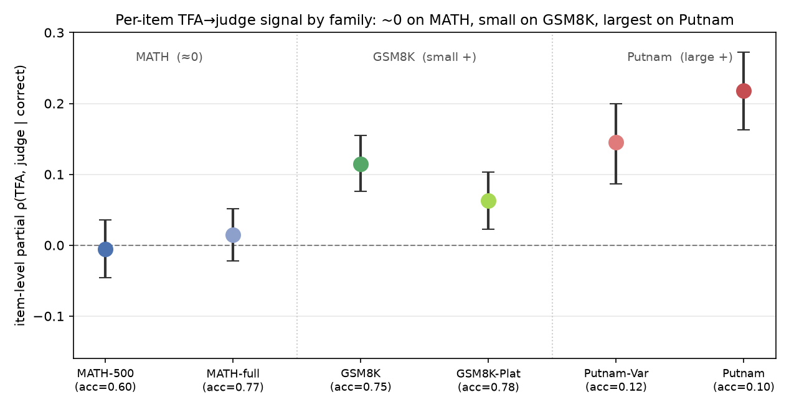
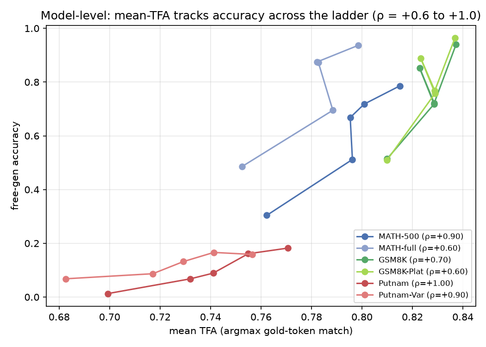

# When can a judge-free signal grade math reasoning?
### Teacher-Forced Accuracy (TFA) across GSM8K, MATH, and Putnam-AXIOM

**TL;DR.** TFA (does the model's argmax reproduce the gold solution token-by-token?) is a **rock-solid model-level ranker** but a **weak per-item grader** — and its per-item usefulness depends entirely on the dataset. It is worthless on MATH, small-but-real on GSM8K, and largest on the hardest data (Putnam). The per-item signal is **not** a memorization or length artifact.

---

## What we ran

- **5 models**: Qwen2.5 {0.5B, 1.5B, 3B, 7B, 14B}-Instruct.
- **6 datasets**: MATH-500, MATH-full (algebra, n=600), GSM8K, GSM8K-Platinum (clean labels), Putnam-AXIOM (original), Putnam-Variations (functional/contamination control).
- **Signal**: mean TFA (argmax gold-token match under teacher forcing).
- **Ground truth**: gpt-5.2 judge (0–10) + boxed correctness (Math-Verify).
- **Decision metric**: item-level **partial ρ(TFA, judge | correct)** — does TFA track judged quality *beyond* just being right? — with 95% bootstrap CIs, length-controlled.

---

## Headline table

*(All rows use the identical 5-model Qwen2.5 ladder {0.5, 1.5, 3, 7, 14B}. 32B was also run on MATH-500 but dropped here for apples-to-apples comparison.)*

| dataset | n | acc | TFA range | **model-level** ρ(TFA,judge) | **item-level** partial ρ(TFA,judge \| correct) | length-controlled |
|---|---:|---:|---|:---:|:---:|:---:|
| MATH-500 | 2500 | 0.60 | 0.76–0.82 | **+0.90** | −0.01 [−0.05, +0.04] | +0.08 |
| MATH-full | 2999 | 0.77 | 0.75–0.80 | +0.60 | +0.02 [−0.02, +0.05] | +0.04 |
| GSM8K | 2500 | 0.75 | 0.81–0.84 | **+0.90** | +0.12 [+0.08, +0.16] | +0.11 |
| GSM8K-Plat | 2500 | 0.78 | 0.81–0.84 | +0.70 | +0.06 [+0.02, +0.10] | +0.09 |
| Putnam | 1180 | 0.10 | 0.70–0.77 | **+1.00** | **+0.22 [+0.16, +0.27]** | +0.24 |
| Putnam-Var | 1325 | 0.12 | 0.68–0.76 | **+1.00** | +0.15 [+0.09, +0.20] | +0.17 |

> **Takeaway:** Model-level ranking works everywhere (ρ = +0.6 to +1.0). Per-item grading is ~zero on MATH (CI straddles 0), small on GSM8K, and only meaningful (≈+0.2) on Putnam — and even there it's far too weak to replace a judge.

---

## Figure 1 — The per-item signal is a *dataset-family* effect

> **Takeaway:** TFA's item-level signal is statistically ~0 on MATH (both subsets, CIs straddle 0), small-positive on GSM8K, and largest on the hardest data (Putnam). It is *not* a smooth function of accuracy — it's a family/difficulty effect: on saturated MATH, TFA is pinned near ceiling and carries no per-item information.

## Figure 2 — Model-level: TFA ranks models monotonically, always

> **Takeaway:** On every dataset, average TFA rises monotonically with accuracy across the Qwen ladder — this is TFA's validated, reliable use case (ranking models without a judge).

## Figure 3 — Why item-level fails on easy data: saturation

> **Takeaway:** On easy data (MATH/GSM8K) all five models sit in a narrow TFA band (~0.03 wide) — TFA is saturated and can't discriminate items; on hard Putnam it spreads out (~0.07), regaining resolution. Harder data = more usable TFA signal.

## Figure 4 — The Putnam/GSM8K signal is real, not an artifact

> **Takeaway:** The item signal survives two controls — cleaning GSM8K's label noise (+0.12→+0.06) and swapping Putnam for contamination-proof functional variants (+0.22→+0.15). Both attenuate but stay significantly above zero, so the signal is genuine competence, not memorization or mislabeling.

---

## Bottom line (what to believe)

1. **Judge-free *model ranking* is solved by TFA.** ρ(mean-TFA, judge) = +0.6 to +1.0 on all six datasets. Use it.
2. **Judge-free *per-item grading* is not solved by TFA.** Best case is +0.22 (Putnam) — a weak correlate, not a judge replacement.
3. **The signal exists only where TFA has room to move** (hard, unsaturated data). Easy benchmarks (MATH) pin TFA near ceiling → zero item signal.
4. **What signal exists is real**: length-robust, survives contamination control (functional variants) and label-noise control (Platinum).

## Caveats

- Single judge (gpt-5.2), Qwen-only responses. MATH-full = algebra subject only (larger but one-subject).
- Putnam correct-stratum is small (acc≈0.10); the robust part there is the within-*wrong* stratum.
- GSM8K vs Platinum are overlapping-but-not-identical item sets, so the label-noise delta is directional, not a paired ablation.
- Boxed correctness is Math-Verify (FP-prone on complex Putnam answers); the judge is the primary quality signal.

## Reproducibility

Raw rollouts, per-gold-token records (argmax/logprob), and seeds saved to `/dfs/scratch0/srivatsavad/jfe_raw/`. Numbers regenerate from `runs/*/*.judged.jsonl` via `scripts/analyze_workstream_a2.py` and `scripts/make_figures.py` → `paper/summary.json`. Full method + bug post-mortems: `JOURNAL.md §4b`.
